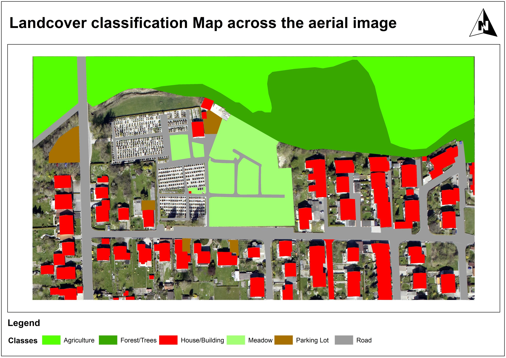

# Manual Land-Cover Classification of Aerial Imagery

**Category:** Remote Sensing & Earth Observation &nbsp;·&nbsp; **Location:** Aerial image tile &nbsp;·&nbsp; **Year:** 2024  
**Client:** Upwork client (geomatics firm)  
**Tools & data:** ArcGIS 10.8, Visual interpretation, Digitising

*Figure 1. Manually digitised land-cover classification of the aerial image*

## Overview
Produced a land-cover map of a high-resolution aerial image by manual interpretation and digitising, delivered as a map and shapefile.

## Challenge
Classify land cover on a non-georeferenced aerial photo by eye, consistently and in a way someone else could repeat.

## Data
- Aerial image supplied by the client (not georeferenced)

## Approach
1. Built an interpretation key for six classes (meadow, agriculture, buildings, roads, parking lots, forest/trees) using colour, texture, structure, size, shape and context
2. Created a polygon feature class with a Class field and digitised every feature with snapping on to avoid gaps and overlaps
3. Used a minimum mapping unit of about 10 m² to keep the map readable
4. Logged ambiguous polygons (for example road vs parking lot) in a separate table with the reasoning for each decision

## Results
- Complete land-cover map with attributed polygons delivered as a shapefile
- Interpretation key and ambiguity table make the classification reproducible
- Recommended georeferencing the image first and a second-reviewer check for ambiguous areas

## Deliverables

- Landcover classification Map across the aerial image.jpg
- Manual Image Classification Report.pdf
- Manual_Classification SHP.rar

---
[← All projects](../../README.md) · [Portfolio website](https://abdul-haleem-khan-rs-gis.github.io/Geospatial_Portfolio/projects/aerial-image-manual-classification.html)
