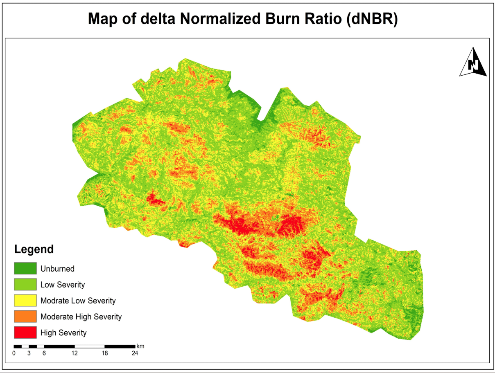

# Burn Severity Analysis (NBR / dNBR)

**Category:** Remote Sensing & Earth Observation &nbsp;·&nbsp; **Location:** Wildfire-affected landscape &nbsp;·&nbsp; **Year:** 2024  
**Client:** Upwork client (geomatics firm)  
**Tools & data:** Sentinel-2, Google Earth Engine, ArcGIS Pro

## Overview
Mapped wildfire damage from pre- and post-fire Sentinel-2 imagery using false-colour composites, the Normalized Burn Ratio (NBR) and delta NBR (dNBR).

## Approach
1. Pre- and post-fire Sentinel-2 scenes
2. False-colour composites for vegetation health
3. NBR for each date, then dNBR
4. Burn-severity classes and report

## Result
Showed significant burn damage in November 2019 and vegetation recovery by January 2020, supporting ecological monitoring and rehabilitation planning.

## Deliverables

- Task 4 Remote Sensing Data Analysis Report.pdf

---
[← All projects](../../README.md) · [Portfolio website](https://abdul-haleem-khan-rs-gis.github.io/Geospatial_Portfolio/projects/burn-severity-sentinel2.html)
