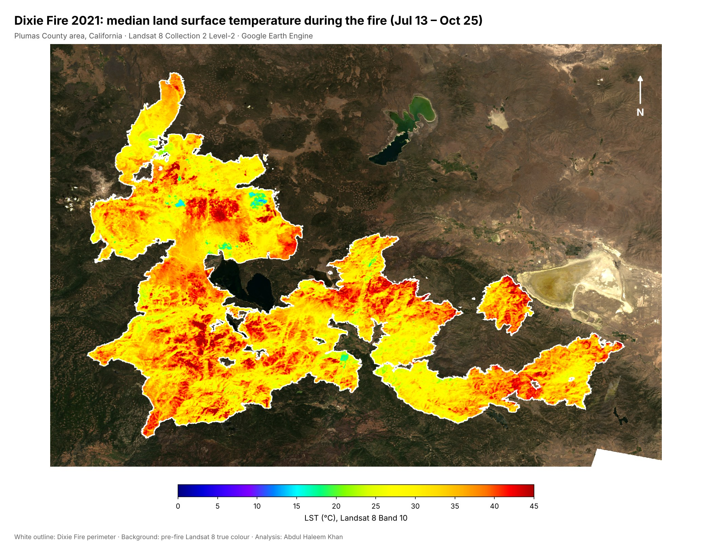
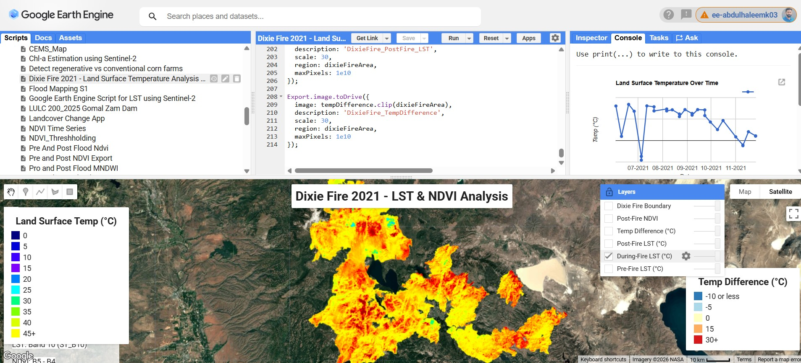

# Dixie Fire 2021: Land Surface Temperature & NDVI in Google Earth Engine

**Category:** Remote Sensing & Earth Observation &nbsp;·&nbsp; **Location:** Dixie Fire, Plumas County area, California, USA &nbsp;·&nbsp; **Year:** 2021 fire season  
**Client:** Independent Earth Engine analysis  
**Tools & data:** Google Earth Engine (JavaScript), Landsat 8 C2 L2, LST, NDVI, Time series

*Figure 1. Median land surface temperature inside the Dixie Fire perimeter during the fire (Landsat 8 Band 10)*

*Figure 2. Temperature change: during-fire minus pre-fire median LST*

*Figure 3. Post-fire NDVI inside the perimeter (Oct 25 – Nov 30, 2021)*

*Figure 4. The Earth Engine app: layers, legends and the LST time-series chart in the Code Editor*

## Overview
Google Earth Engine app that tracks the 2021 Dixie Fire, California's largest single wildfire, through Landsat 8 land surface temperature and NDVI before, during and after the fire, with legends, time-series charts and GeoTIFF exports.

## Challenge
Measure how a very large wildfire changed the land surface, from heat to vegetation, using only free satellite data. The aim was to run everything in the cloud, over a 3,894 km² burn perimeter, without downloading a single scene.

## Data
- Landsat 8 Collection 2 Level-2 surface reflectance and surface temperature (LANDSAT/LC08/C02/T1_L2), June–November 2021
- Dixie Fire perimeter uploaded as an Earth Engine asset (3,894 km²)
- Periods: pre-fire Jun 1 – Jul 13 (7 scenes), during-fire Jul 13 – Oct 25 (16 scenes), post-fire Oct 25 – Nov 30, 2021 (6 scenes)

## Approach
1. Filtered the Landsat 8 collection to the fire perimeter and the June–November 2021 window
2. Converted thermal Band 10 (ST_B10) to land surface temperature in °C with the Collection 2 scale factors (× 0.00341802 + 149.0 − 273.15)
3. Calculated NDVI from Band 5 (NIR) and Band 4 (red) for every scene
4. Split the collection at the ignition date (13 July) and the containment date (25 October) and took median composites for each period
5. Subtracted pre-fire from during-fire LST to map temperature change
6. Built the app interface: title, layer list, LST and temperature-difference legends and an information panel
7. Charted mean LST and NDVI over the perimeter for every scene, and set up 30 m GeoTIFF exports to Google Drive for each LST layer and the difference map

## Results
- Mean NDVI inside the perimeter fell from 0.24 before the fire to 0.09 after it, a drop of about 63%, showing extensive vegetation loss
- The time-series chart tracks how surface temperature over the burn area changed through the fire season
- Median LST over the perimeter: 35.1 °C before the fire and 33.6 °C during it. Smoke and cloud in the during-fire scenes lower the thermal signal, so much of the difference map shows cooling
- Next step: apply the cloud-mask function (already written in the script) to every scene, and add a smoke filter, to sharpen the temperature-change map

## Links

- [Open in the Earth Engine Code Editor](https://code.earthengine.google.com/5fbd35d270e92e2c852970e16b9c2db1)
- [View the script on GitHub](https://github.com/Abdul-Haleem-Khan-RS-GIS/spatial-analysis-showcase/blob/main/01-Remote-Sensing/gee-dixie-fire-lst-ndvi/code/dixie_fire_lst_ndvi.js)

## Deliverables

- code/dixie_fire_lst_ndvi.js (full Earth Engine script)
- Four maps (LST, temperature change, NDVI, app view)

---
[← All projects](../../README.md) · [Portfolio website](https://abdul-haleem-khan-rs-gis.github.io/Geospatial_Portfolio/projects/gee-dixie-fire-lst-ndvi.html)
