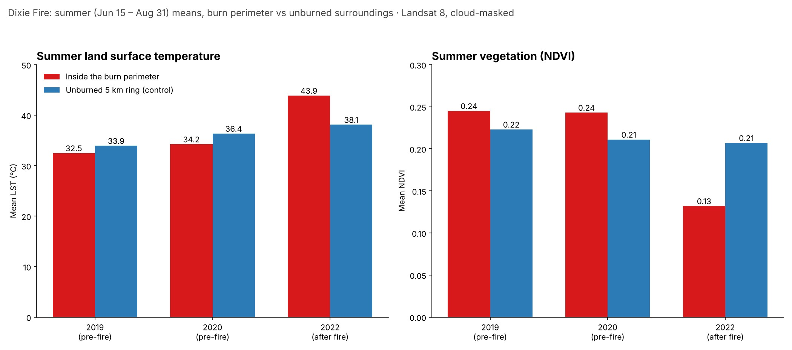
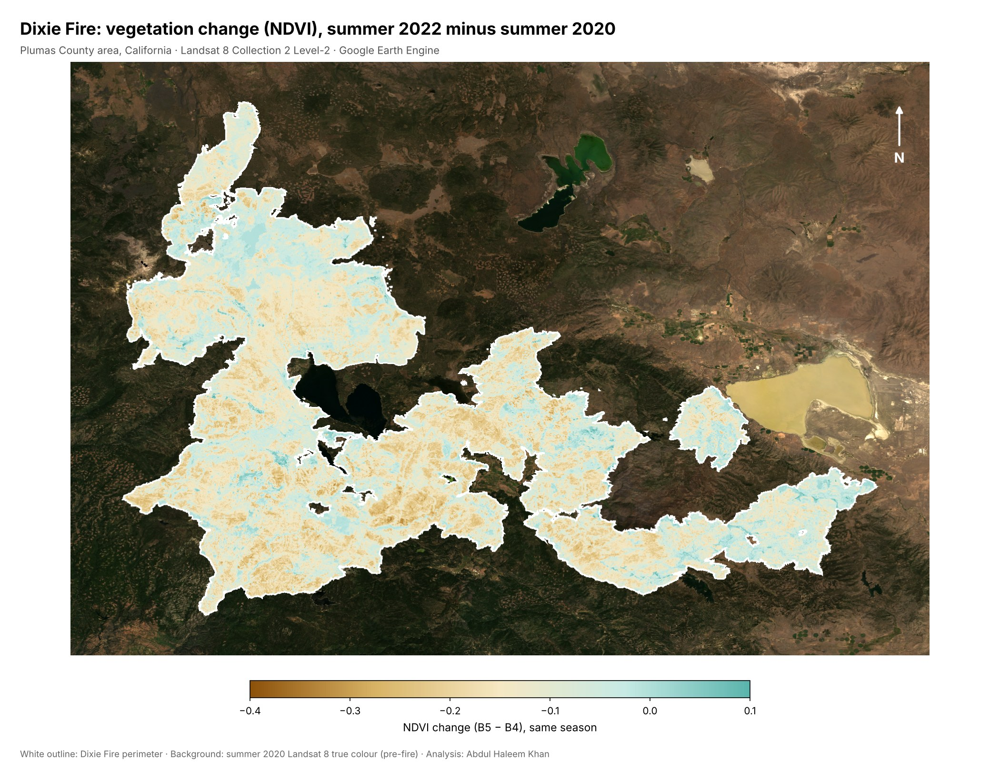

# Dixie Fire 2021: Land Surface Temperature & NDVI in Google Earth Engine

**Category:** Remote Sensing & Earth Observation &nbsp;·&nbsp; **Location:** Dixie Fire, Plumas County area, California, USA &nbsp;·&nbsp; **Year:** 2021 fire season  
**Client:** Independent Earth Engine analysis  
**Tools & data:** Google Earth Engine (JavaScript), Landsat 8 C2 L2, LST, NDVI, Time series

*Figure 1. Land surface temperature change in the same season, summer 2022 minus summer 2020 (cloud-masked)*

*Figure 2. Summer means inside the burn perimeter vs the unburned 5 km ring, 2019, 2020 and 2022*

*Figure 3. Vegetation change (NDVI), summer 2022 minus summer 2020*

*Figure 4. Land surface temperature in the first summer after the fire (2022)*

## Overview
Google Earth Engine analysis of the 2021 Dixie Fire, California's largest single wildfire: cloud-masked Landsat 8 land surface temperature and NDVI, compared season to season against an unburned control ring, showing the burn scar ran about 8 °C hotter the next summer.

## Challenge
Measure how a very large wildfire changed the land surface, from heat to vegetation, using only free satellite data processed in the cloud over the 3,894 km² burn perimeter. The first version compared June (before the fire) with July–October (during it). Because of the seasonal cooling and smoke, it wrongly suggested the burned area had cooled, so the method had to be fixed.

## Data
- Landsat 8 Collection 2 Level-2 surface reflectance and surface temperature (LANDSAT/LC08/C02/T1_L2), 2019–2022
- Dixie Fire perimeter uploaded as an Earth Engine asset (3,894 km²)
- Unburned control ring: a 5 km band around the perimeter
- 2021 fire season: ignition 13 July, containment 25 October; impact comparison: summer (Jun 15 – Aug 31) 2020 vs 2022

## Approach
1. Applied a QA_PIXEL mask to every Landsat scene to remove cloud, dilated cloud, cirrus, cloud shadow and snow
2. Converted thermal Band 10 to land surface temperature in °C with the Collection 2 scale factors, and calculated NDVI from Bands 5 and 4
3. Kept the 2021 fire-season layers (pre-, during- and post-fire median LST, post-fire NDVI)
4. Measured fire impact season to season: median summer 2022 minus median summer 2020, for both LST and NDVI, so normal seasonal cooling no longer hides the signal
5. Used a 5 km unburned ring around the perimeter as a control, to separate the fire effect from year-to-year weather
6. Printed burn-scar vs control-ring statistics, charted both regions from June 2020 to September 2022, and set up 30 m GeoTIFF exports for all change layers

## Results
- Summer land surface temperature inside the perimeter rose from 34.2 °C (2020) to 43.9 °C (2022), +9.7 °C, while the unburned ring rose only 1.7 °C
- Before the fire, the forest was 1.4–2.1 °C cooler than its surroundings (2019 and 2020). After the fire, it was 5.8 °C hotter: a swing of about 8 °C caused by the burn
- Summer NDVI inside the perimeter fell from 0.24 to 0.13 (about −46%), while the control ring stayed at 0.21: vegetation loss limited to the burn scar
- Lesson learned: comparing different seasons, without cloud masking, gave a false cooling signal. Season-to-season comparison with a control area gave a clear, defensible result

## Links

- [Open in the Earth Engine Code Editor](https://code.earthengine.google.com/41b9b32b5c8690a4727865efe43eb71a)
- [View the script on GitHub](https://github.com/Abdul-Haleem-Khan-RS-GIS/spatial-analysis-showcase/blob/main/01-Remote-Sensing/gee-dixie-fire-lst-ndvi/code/dixie_fire_lst_ndvi.js)

## Deliverables

- code/dixie_fire_lst_ndvi.js (full Earth Engine script)
- Maps: LST change, NDVI change, summer 2022 LST; summer comparison chart

---
[← All projects](../../README.md) · [Portfolio website](https://abdul-haleem-khan-rs-gis.github.io/Geospatial_Portfolio/projects/gee-dixie-fire-lst-ndvi.html)
