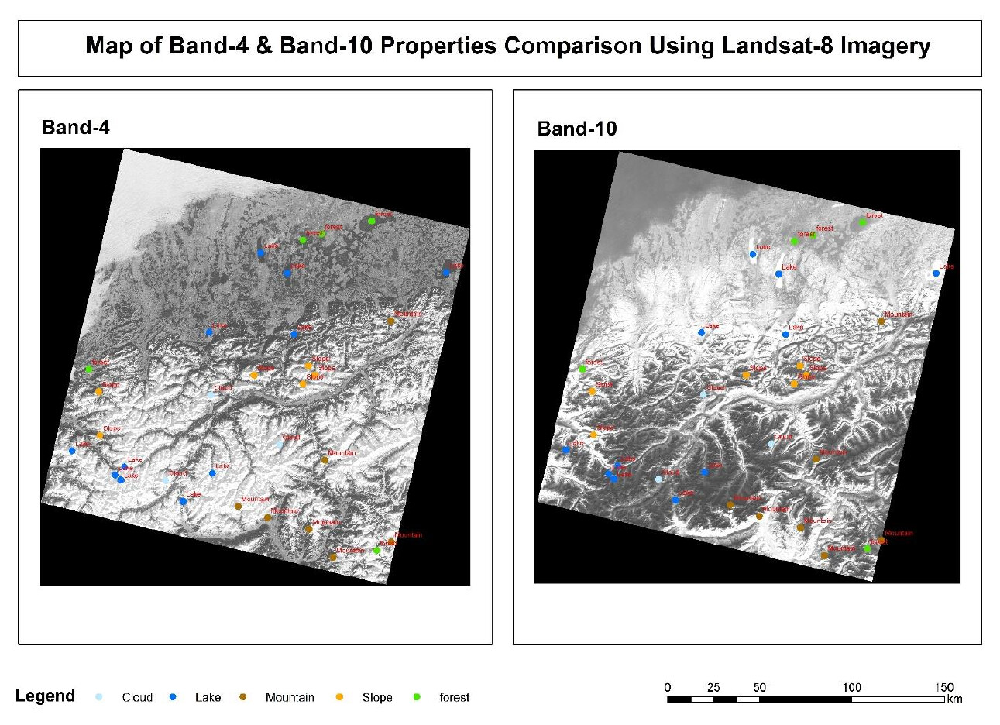
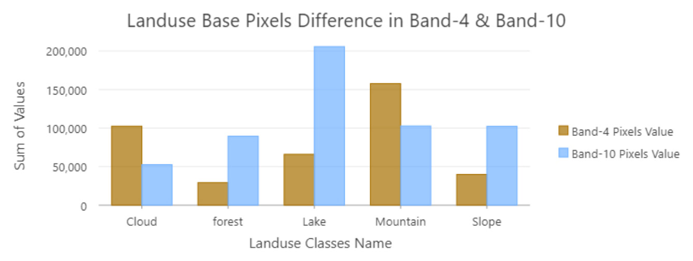
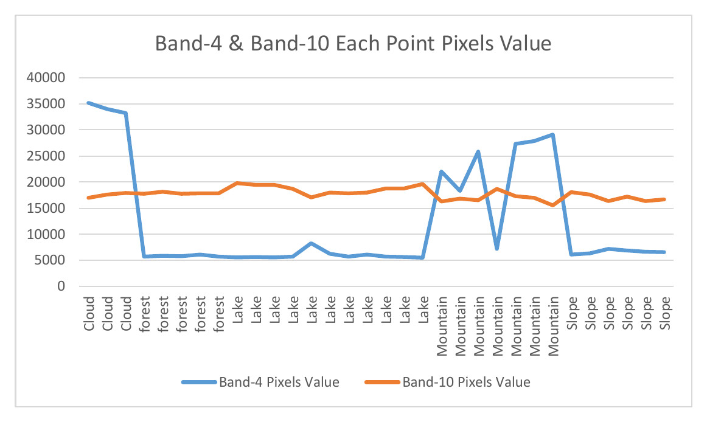

# Landsat Band 4 & Band 10 Surface Analysis

**Category:** Remote Sensing & Earth Observation &nbsp;·&nbsp; **Location:** Study area &nbsp;·&nbsp; **Year:** 2024  
**Client:** Upwork client (geomatics firm)  
**Tools & data:** Landsat 8, ArcGIS Pro, Excel

*Figure 1. Band 4 and Band 10 side by side (Landsat 8) with the 32 sample points by class*

*Figure 2. Total pixel values by land-cover class in Band 4 and Band 10*

*Figure 3. Band 4 and Band 10 pixel value at each of the 32 sample points*

## Overview
Analysed Band 4 (red) and Band 10 (thermal) pixel values to tell apart clouds, water, snow and land-cover types including forest, mountains and slopes.

## Data
- Landsat 8 scene: Band 4 (visible red) and Band 10 (thermal infrared)
- 32 sample points in five classes: 3 cloud, 5 forest, 11 lake, 7 mountain and 6 slope

## Approach
1. Displayed Band 4 and Band 10 side by side and placed 32 sample points over clouds, forests, lakes, mountains and slopes
2. Extracted the Band 4 and Band 10 pixel value at every point
3. Charted the totals by class and the value at each point to compare reflectance with thermal emission
4. Explained the differences physically: reflectivity, heat retention, altitude, surface material and sun exposure
5. Wrote a companion report recommending the right sensor for five use cases (Sentinel-2, Sentinel-1, MODIS, WorldView-3, Meteosat)

## Results
- Clouds have the highest Band 4 values (33,254–35,173) but only moderate Band 10 values (16,972–17,897)
- Lakes have low Band 4 values (5,519–8,322) but the highest Band 10 values (17,065–19,795), because water absorbs light and holds heat
- Mountains vary most: Band 4 from 7,169 to 29,096 and Band 10 from 15,541 to 18,701, depending on snow, rock and height
- Slopes (Band 10: 16,333–18,091) are warmer when south-facing; forests sit in a narrow thermal range (17,730–18,189)
- Snow and cloud look alike in Band 4 but separate in Band 10, where snow is much colder (expected below about 15,000)

## Deliverables

- Report on the Analysis of Band 4 & 10.pdf
- Report Evaluating Remote Sensing Data for Specific Use Cases.pdf

---
[← All projects](../../README.md) · [Portfolio website](https://abdul-haleem-khan-rs-gis.github.io/Geospatial_Portfolio/projects/landsat-band4-band10-analysis.html)
