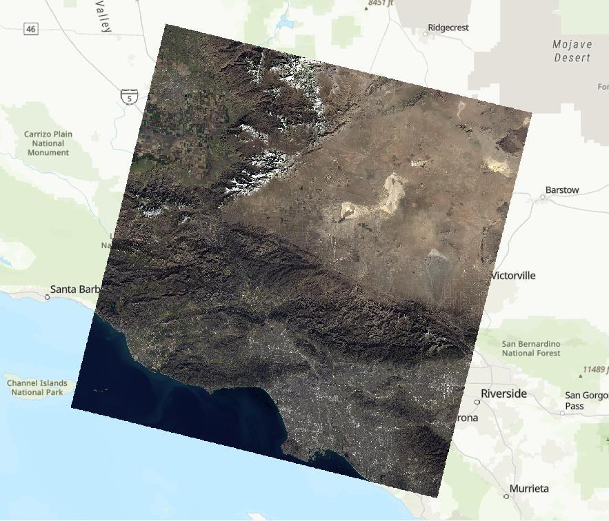

# Landsat 9 Thermal & Image Analysis

**Category:** Remote Sensing & Earth Observation &nbsp;·&nbsp; **Location:** Southern California (Landsat 9 scene, June 2022) &nbsp;·&nbsp; **Year:** 2024  
**Client:** Practice study  
**Tools & data:** Landsat 9, ArcGIS Pro

> Practice study. Course and client details are omitted.

## Overview
Analysed a Landsat 9 Collection 2 scene (15 June 2022): band composites, thermal band interpretation and surface analysis.

## Approach
1. Landsat 9 C2 L2 scene
2. Band composites
3. Thermal band analysis
4. Reports

## Result
Two illustrated reports on Landsat image analysis and thermal interpretation.

## Deliverables

- Landsat 2024 Image Analysis Assignment.pdf
- Thermal Lab- Week 2-1.pdf

---
[← All projects](../../README.md) · [Portfolio website](https://abdul-haleem-khan-rs-gis.github.io/Geospatial_Portfolio/projects/landsat-thermal-and-image-analysis.html)
