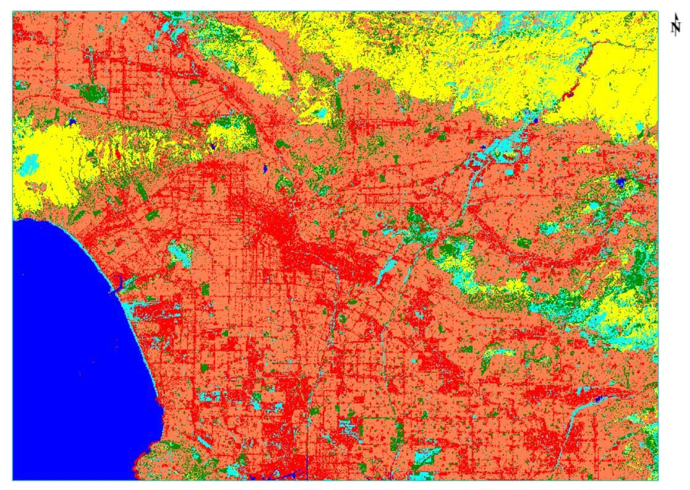
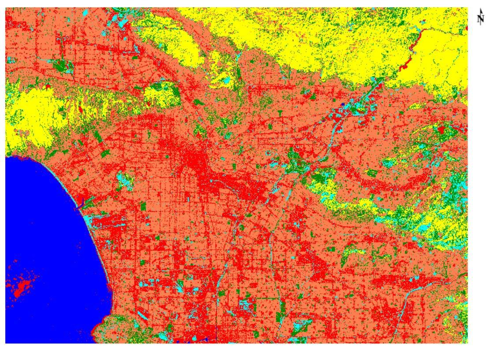
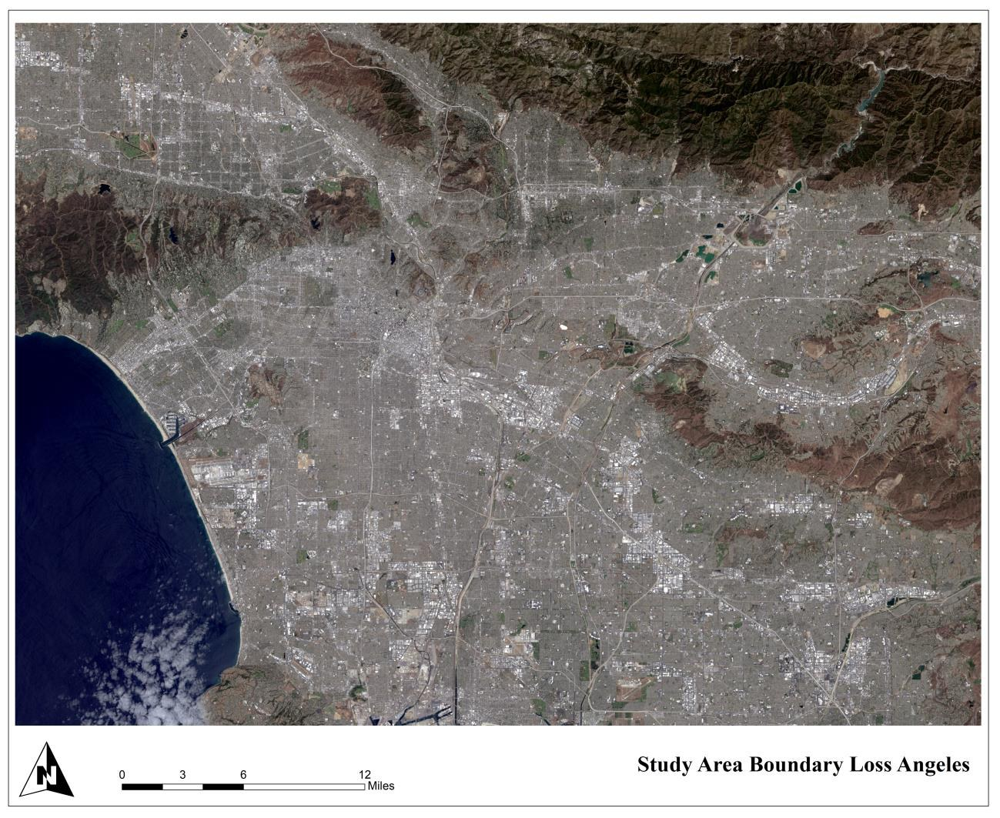

# Urban Land-Cover Classification of Los Angeles

**Category:** Remote Sensing & Earth Observation &nbsp;·&nbsp; **Location:** Los Angeles, USA &nbsp;·&nbsp; **Year:** 2024  
**Client:** Practice study  
**Tools & data:** Landsat 8 OLI, ENVI, Maximum Likelihood, Correlation analysis

> Practice study. Course and client details are omitted.

*Figure 1. Maximum Likelihood land-cover classification of Los Angeles (six classes)*

*Figure 2. Maximum Likelihood land-cover classification for a second year, used for change comparison*

*Figure 3. Study area: Los Angeles metropolitan region on Landsat 8*

## Overview
Classified urban land cover across the Los Angeles metropolitan area for 2019, 2022 and 2024 with Maximum Likelihood Classification of Landsat 8 imagery, to measure urban densification and changes in green space.

## Challenge
Measure how Los Angeles land cover changed between 2019 and 2024: where the city densified, and what happened to vegetation, water and bare soil.

## Data
- Landsat 8 OLI scenes for 2019, 2022 and 2024 (USGS EarthExplorer), bands 2–7
- Regions of interest for six classes: water, high-density urban, low-density urban, irrigated lawns, natural vegetation, bare soil

## Approach
1. Radiometric calibration, atmospheric correction and subsetting to the metropolitan area
2. Selected ROIs for the six classes and checked their spectral signatures
3. Ran a Pearson correlation analysis between bands and excluded bands correlated above 0.85; bands 5, 1 and 7 were the least correlated
4. Classified each year with Maximum Likelihood and assessed accuracy with confusion matrices and Kappa
5. Compared class areas across the three years

## Results
- High-density urban grew from 76.71 km² (2019) to 78.56 km² (2024) while low-density urban fell from 195.75 to 186.51 km², a sign of densification
- Bare soil declined from 22.00 to 18.37 km² as development reached undeveloped land
- Irrigated lawns rose from 38.16 to 41.71 km²; natural vegetation dipped to 57.39 km² in 2022 and recovered to 63.15 km² in 2024
- Water rose from 35.83 km² (2019) to 42.92 km² (2022), then 41.50 km² (2024)

## Deliverables

- Classification of Urban Land Cover in Los Angeles Using Remote Sensing Techniques.pdf
- Classification of Urban Land Cover in Los Angeles.pptx

---
[← All projects](../../README.md) · [Portfolio website](https://abdul-haleem-khan-rs-gis.github.io/Geospatial_Portfolio/projects/los-angeles-urban-land-cover.html)
