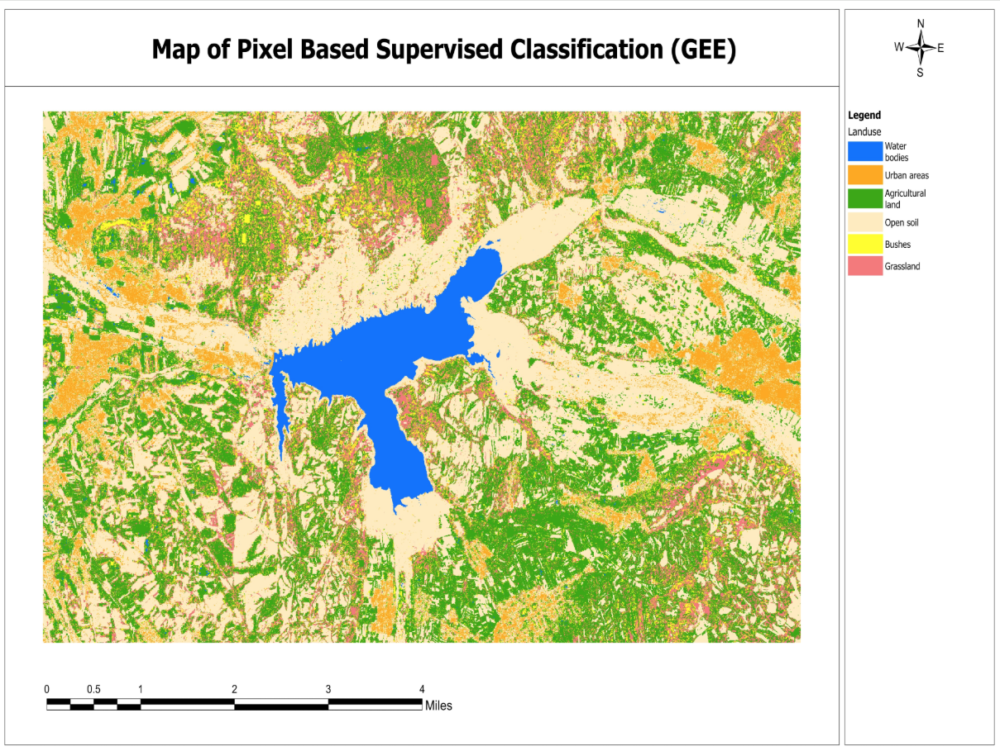

# Land-Cover Classification: Supervised vs Unsupervised

**Category:** Remote Sensing & Earth Observation &nbsp;·&nbsp; **Location:** Andijan Reservoir, Uzbekistan / Kyrgyzstan &nbsp;·&nbsp; **Year:** 2024  
**Client:** Upwork client (geomatics firm)  
**Tools & data:** Sentinel-2, Google Earth Engine, Random Forest, ArcGIS Pro

## Overview
Classified land cover around the Andijan Reservoir from a Sentinel-2 scene of 13 April 2023, comparing unsupervised clustering with supervised Random Forest classification in Google Earth Engine.

## Approach
1. Sentinel-2 scene, 13 Apr 2023
2. ISO Cluster unsupervised classification (7 classes)
3. Training samples + Random Forest in GEE
4. Accuracy comparison and report

## Result
Supervised Random Forest classification produced more detailed and accurate land-cover maps than unsupervised methods; separating mixed land-cover classes remains the main area to improve.

## Deliverables

- Remote Sensing Image Classification Report.pdf

---
[← All projects](../../README.md) · [Portfolio website](https://abdul-haleem-khan-rs-gis.github.io/Geospatial_Portfolio/projects/lulc-andijan-reservoir.html)
