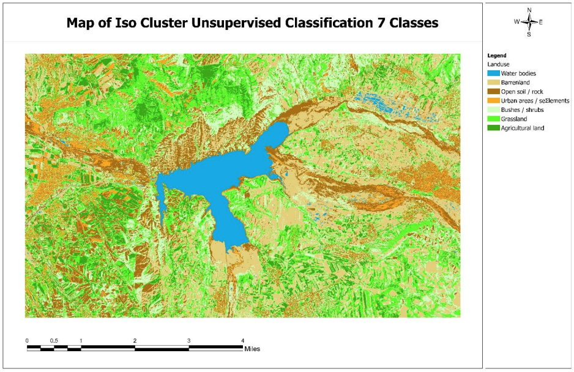

# Land-Cover Classification: Supervised vs Unsupervised

**Category:** Remote Sensing & Earth Observation &nbsp;·&nbsp; **Location:** Andijan Reservoir, Uzbekistan &nbsp;·&nbsp; **Year:** 2024  
**Client:** Upwork client (geomatics firm)  
**Tools & data:** Sentinel-2, ArcGIS Pro, Google Earth Engine, Random Forest, SVM

*Figure 1. Supervised pixel-based classification in Google Earth Engine (Random Forest)*

*Figure 2. ISO Cluster unsupervised classification with 7 classes in ArcGIS Pro*

## Overview
Classified land cover around the Andijan Reservoir from a Sentinel-2 scene of 13 April 2023, comparing unsupervised clustering with supervised Random Forest classification in Google Earth Engine.

## Challenge
Produce a reliable land-cover map around the Andijan Reservoir and work out which classification approach, unsupervised clustering or supervised machine learning, gives the most accurate result.

## Data
- Sentinel-2 image of 13 April 2023 (10 m bands)
- Area of interest digitised around the reservoir from visual assessment
- Training polygons for six classes: water, urban, agricultural land, open soil/rock, shrubs/bushes and grassland

## Approach
1. Ran ISO Cluster unsupervised classification in ArcGIS Pro with 5, 7 and 10 classes and matched each cluster to a real-world land-cover class
2. Uploaded the AOI to Google Earth Engine, clipped the Sentinel-2 scene and drew training polygons for the six classes
3. Used the visible and near-infrared bands and a random split of the samples into training data and a 30% test set
4. Trained and compared Random Forest and Support Vector Machine classifiers, adding samples for difficult classes
5. Assessed accuracy with a confusion matrix in GEE (errorMatrix) and with accuracy-assessment points in ArcGIS Pro

## Results
- Water bodies reached user's and producer's accuracy above 90%
- Urban, open soil, agriculture and bushes reached moderate accuracy (80–90%), with some confusion between them
- Random Forest was more reliable for large classes (water, urban); SVM separated shrubs and grassland slightly better
- Supervised Random Forest in GEE gave the more detailed and accurate map; mixed classes such as shrubland and grassland remain the main area to improve

## Deliverables

- Remote Sensing Image Classification Report.pdf

---
[← All projects](../../README.md) · [Portfolio website](https://abdul-haleem-khan-rs-gis.github.io/Geospatial_Portfolio/projects/lulc-andijan-reservoir.html)
