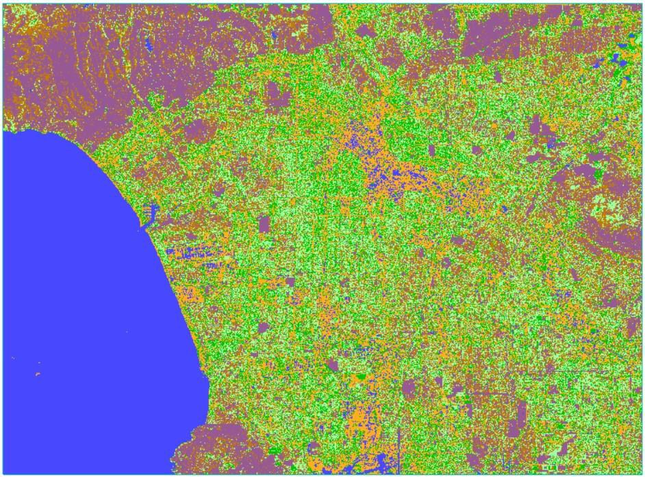
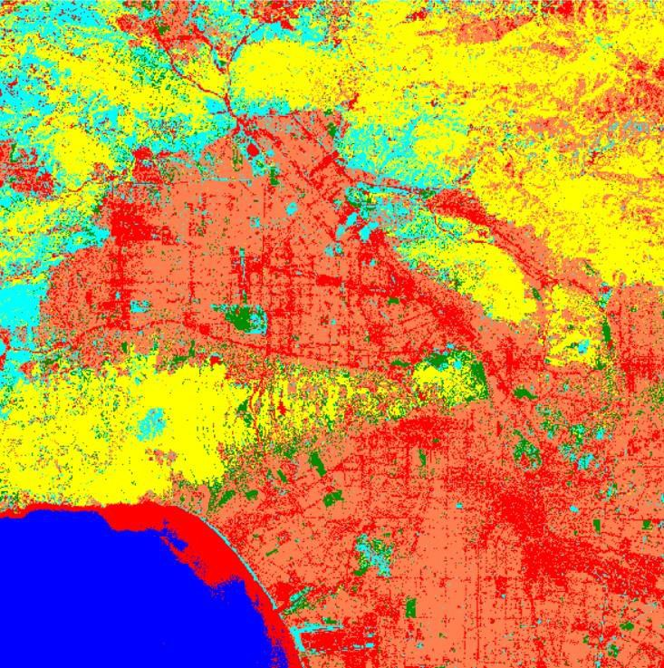

# NDVI, Supervised & Unsupervised Classification Studies

**Category:** Remote Sensing & Earth Observation &nbsp;·&nbsp; **Location:** Los Angeles, USA &nbsp;·&nbsp; **Year:** 2024  
**Client:** Practice studies  
**Tools & data:** ENVI, Landsat 8, Landsat 9, ISODATA, Maximum Likelihood

> Practice study. Course and client details are omitted.

*Figure 1. ISODATA unsupervised classification of west Los Angeles (Landsat 8)*

*Figure 2. Maximum Likelihood supervised classification with six classes (Landsat 9)*

## Overview
Two step-by-step studies on Landsat imagery of Los Angeles: NDVI with ISODATA unsupervised classification, and supervised Maximum Likelihood classification with ROI statistics and band-correlation analysis.

## Challenge
Document, with interpretation at each step, how NDVI and unsupervised and supervised classification behave on an urban Landsat scene.

## Data
- Landsat 8 scene of Los Angeles (multispectral stack from the MTL file)
- Landsat 9 scene of Los Angeles
- NLCD land-cover subset as reference

## Approach
1. Spatial and spectral subset of west Los Angeles (Santa Monica Mountains, urban area and ocean), bands 5-4-3-2
2. True-colour (4-3-2) and false-colour (5-4-3) comparison; NDVI calculated and interpreted
3. ISODATA unsupervised classification and identification of the resulting classes
4. Supervised study: six classes, at least five ROIs and 1,000 pixels per class, ROI statistics, correlation matrix to choose the least correlated bands, then Maximum Likelihood classification and class summary

## Results
- NDVI cleanly separates vegetated hills and parks from the urban core and water
- Unsupervised classes needed manual labelling and merged some urban and soil areas
- Choosing the least correlated bands improved separation of the six supervised classes

## Deliverables

- NDVI and Unsupervised Classification - Week 3 Lab-2.pdf
- Lab 4 Report.pdf

---
[← All projects](../../README.md) · [Portfolio website](https://abdul-haleem-khan-rs-gis.github.io/Geospatial_Portfolio/projects/ndvi-and-image-classification-studies.html)
