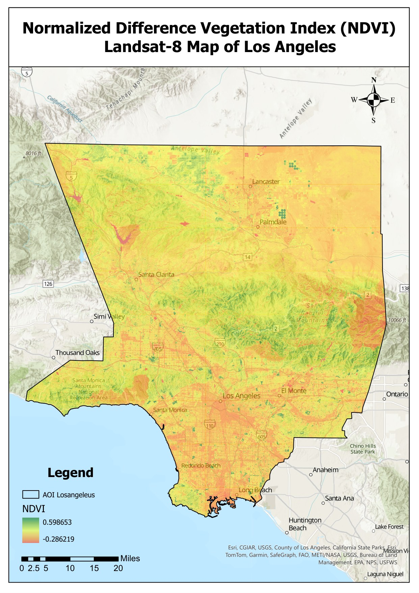

# NDVI Map of Los Angeles County (Landsat 8)

**Category:** Remote Sensing & Earth Observation &nbsp;·&nbsp; **Location:** Los Angeles County, USA &nbsp;·&nbsp; **Year:** 2025  
**Client:** Upwork client  
**Tools & data:** Landsat 8, ArcGIS Pro, NDVI

*Figure 1. NDVI map of Los Angeles County from Landsat 8*

## Overview
Quick-turnaround NDVI computation from Landsat 8 for Los Angeles County, with a summary layout in ArcGIS Pro.

## Challenge
Produce a clear NDVI map of Los Angeles County within a strict 20-minute time limit.

## Data
- Landsat 8 surface reflectance (pre-processed)
- Los Angeles County AOI
- Esri basemap

## Approach
1. Selected pre-processed Landsat 8 surface reflectance to save time
2. Calculated NDVI = (NIR − Red) / (NIR + Red) and clipped it to the county
3. Applied a green-to-orange ramp and a pre-built layout template

## Results
- NDVI ranged from −0.29 to 0.60 across the county
- Healthy vegetation in the mountains and parks stands out from the urban basin and barren areas

## Deliverables

- Summary of Normalized Difference Vegetation Index (NDVI).pdf

---
[← All projects](../../README.md) · [Portfolio website](https://abdul-haleem-khan-rs-gis.github.io/Geospatial_Portfolio/projects/ndvi-summary-arcgis-pro.html)
