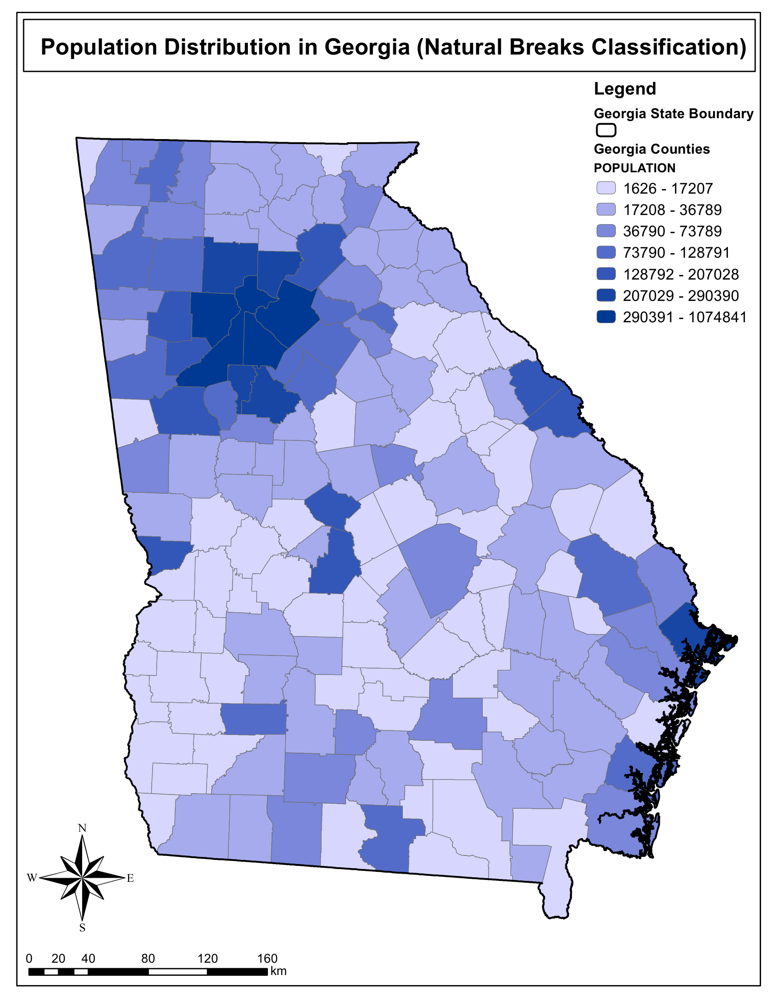
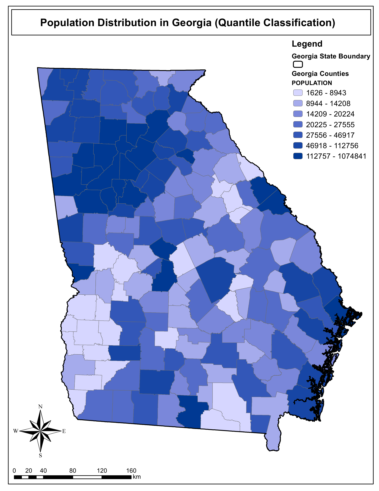
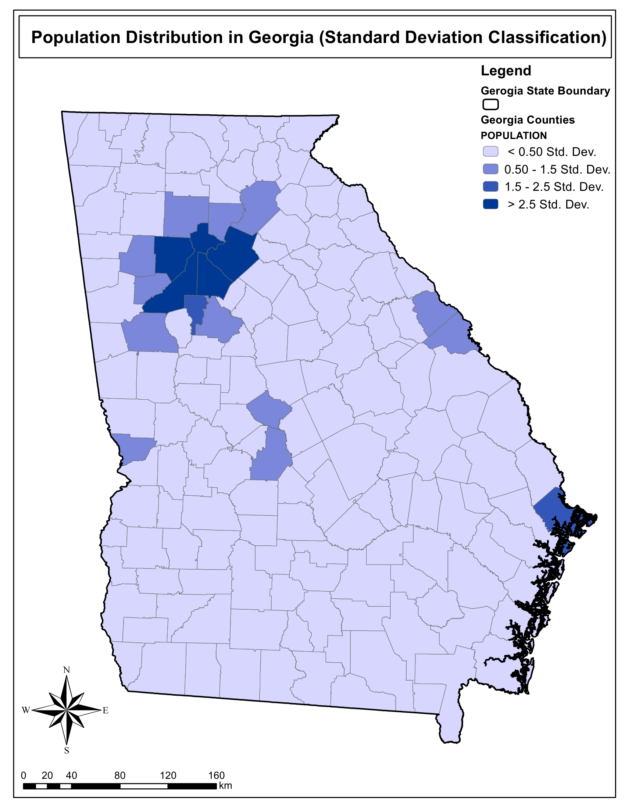

# Choropleth Classification Comparison: Georgia

**Category:** Cartography & Thematic Mapping &nbsp;·&nbsp; **Location:** Georgia, USA (159 counties) &nbsp;·&nbsp; **Year:** 2025  
**Client:** Upwork client  
**Tools & data:** ArcGIS 10.8, 2020 U.S. Census, TIGER/Line

*Figure 1. Equal Interval classification*

*Figure 2. Natural Breaks (Jenks) classification*

*Figure 3. Quantile classification*

*Figure 4. Standard Deviation classification*

## Overview
Mapped U.S. Census population for Georgia's 159 counties four ways (Equal Interval, Quantile, Natural Breaks, Standard Deviation) with matching layouts.

## Challenge
Show how the choice of classification method changes what a choropleth map says about the same data.

## Data
- 2020 U.S. Census population for Georgia's 159 counties
- TIGER/Line county boundaries
- NAD 1983 StatePlane Georgia West (feet)

## Approach
1. Cleaned the attributes, removed nulls and projected to StatePlane Georgia West
2. Mapped population with Equal Interval, Natural Breaks (Jenks), Quantile and Standard Deviation, using matching layouts
3. Compared the advantages and drawbacks of each method in a one-page analysis

## Results
- Equal Interval hides most variation: almost every county falls in the lowest class (1,626–154,942)
- Quantile forces equal groups and exaggerates differences among rural counties
- Natural Breaks (Jenks) gives the most meaningful picture, showing the Atlanta concentration while still separating rural counties
- Standard Deviation highlights the extreme metro counties but is hard for non-specialists to read

## Deliverables

- Comparison of Population Distribution in Georgia Using Different Classification Methods.pdf

---
[← All projects](../../README.md) · [Portfolio website](https://abdul-haleem-khan-rs-gis.github.io/Geospatial_Portfolio/projects/georgia-choropleth-classification.html)
