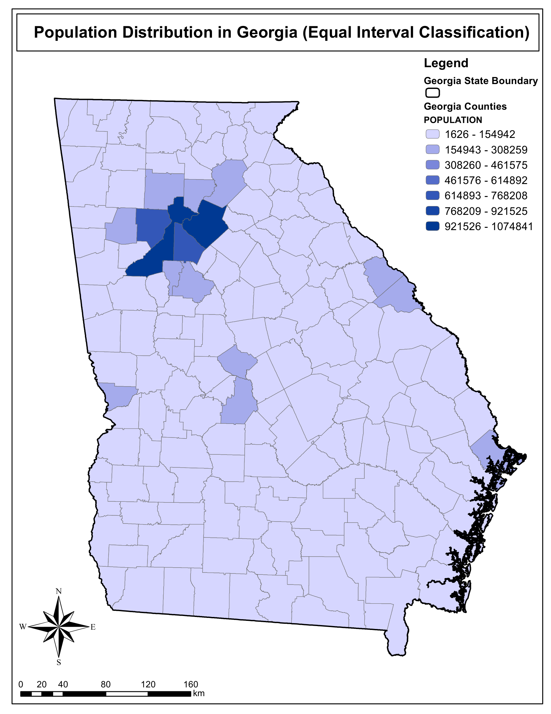

# Choropleth Classification Comparison: Georgia

**Category:** Cartography & Thematic Mapping &nbsp;·&nbsp; **Location:** Georgia, USA (159 counties) &nbsp;·&nbsp; **Year:** 2025  
**Client:** Upwork client  
**Tools & data:** ArcGIS 10.8, U.S. Census data

## Overview
Mapped U.S. Census population for Georgia's 159 counties four ways (Equal Interval, Quantile, Natural Breaks, Standard Deviation) with matching layouts.

## Approach
1. Census population data
2. Join to county boundaries
3. Four classification methods
4. Consistent layouts + report

## Result
Four-map series and a one-page analysis of how classification choice changes the story a map tells.

## Deliverables

- Comparison of Population Distribution in Georgia Using Different Classification Methods.pdf

---
[← All projects](../../README.md) · [Portfolio website](https://abdul-haleem-khan-rs-gis.github.io/Geospatial_Portfolio/projects/georgia-choropleth-classification.html)
