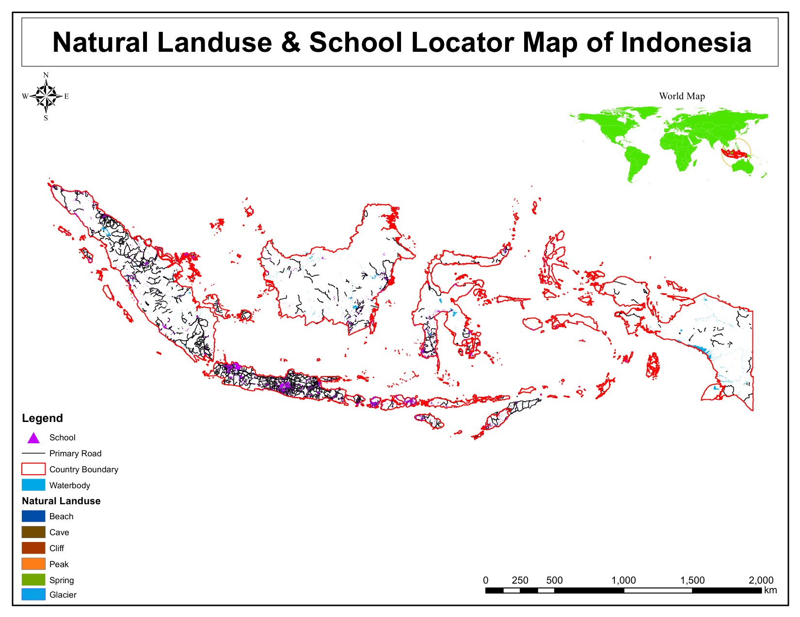

# Land Use & School Locator Map: Wonosobo, Indonesia

**Category:** Cartography & Thematic Mapping &nbsp;·&nbsp; **Location:** Wonosobo, Indonesia &nbsp;·&nbsp; **Year:** 2025  
**Client:** Upwork client  
**Tools & data:** ArcGIS Pro

*Figure 1. Natural land use and school locator map*

*Figure 2. Location map of Indonesia*

## Overview
Natural land-use map with school locations for Wonosobo, set within a national locator map of Indonesia.

## Challenge
Show natural land use and school locations for Wonosobo, Central Java, together with where the district sits within Indonesia.

## Data
- Natural land-use features: beach, cave, cliff, peak, spring and glacier
- School locations
- Primary roads, water bodies and the national boundary
- World boundaries for the inset

## Approach
1. Built a national map of Indonesia with primary roads, water bodies and the country boundary
2. Mapped natural land-use features in six classes and school locations as point symbols
3. Added a world inset that highlights Indonesia, plus a separate location map at 0–2,000 km scale
4. Produced a district-level version for Wonosobo, Central Java

## Results
- School points concentrate on Java, with further clusters in Sumatra, Bali and the Lesser Sunda islands
- Road density follows the same pattern: dense on Java and Sumatra, sparse in Kalimantan and Papua
- Two layouts delivered: a national land-use and school locator map and a location map of Indonesia

## Deliverables

- Natural Landuse & School Locator Map of Indonesia & Wonosobo.pdf
- indonesia.pdf

---
[← All projects](../../README.md) · [Portfolio website](https://abdul-haleem-khan-rs-gis.github.io/Geospatial_Portfolio/projects/indonesia-landuse-school-locator.html)
