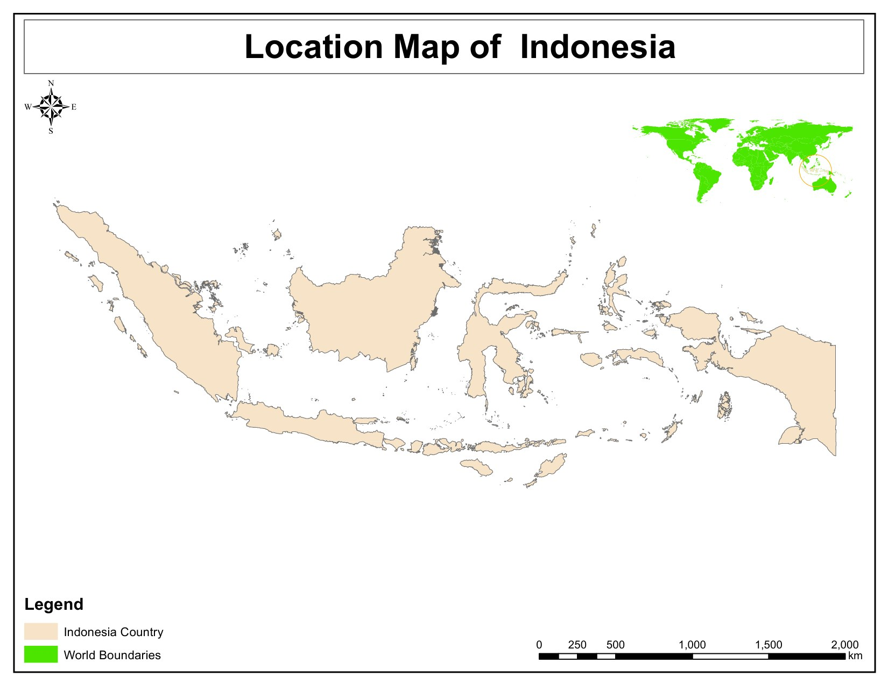

# Land Use & School Locator Map: Wonosobo, Indonesia

**Category:** Cartography & Thematic Mapping &nbsp;·&nbsp; **Location:** Wonosobo, Indonesia &nbsp;·&nbsp; **Year:** 2025  
**Client:** Upwork client  
**Tools & data:** ArcGIS Pro

## Overview
Natural land-use map with school locations for Wonosobo, set within a national locator map of Indonesia.

## Approach
1. Land-use and school data
2. District and national extents
3. Layout with locator

## Result
Two-map layout (national locator + district land use and schools).

## Deliverables

- Natural Landuse & School Locator Map of Indonesia & Wonosobo.pdf
- indonesia.pdf

---
[← All projects](../../README.md) · [Portfolio website](https://abdul-haleem-khan-rs-gis.github.io/Geospatial_Portfolio/projects/indonesia-landuse-school-locator.html)
