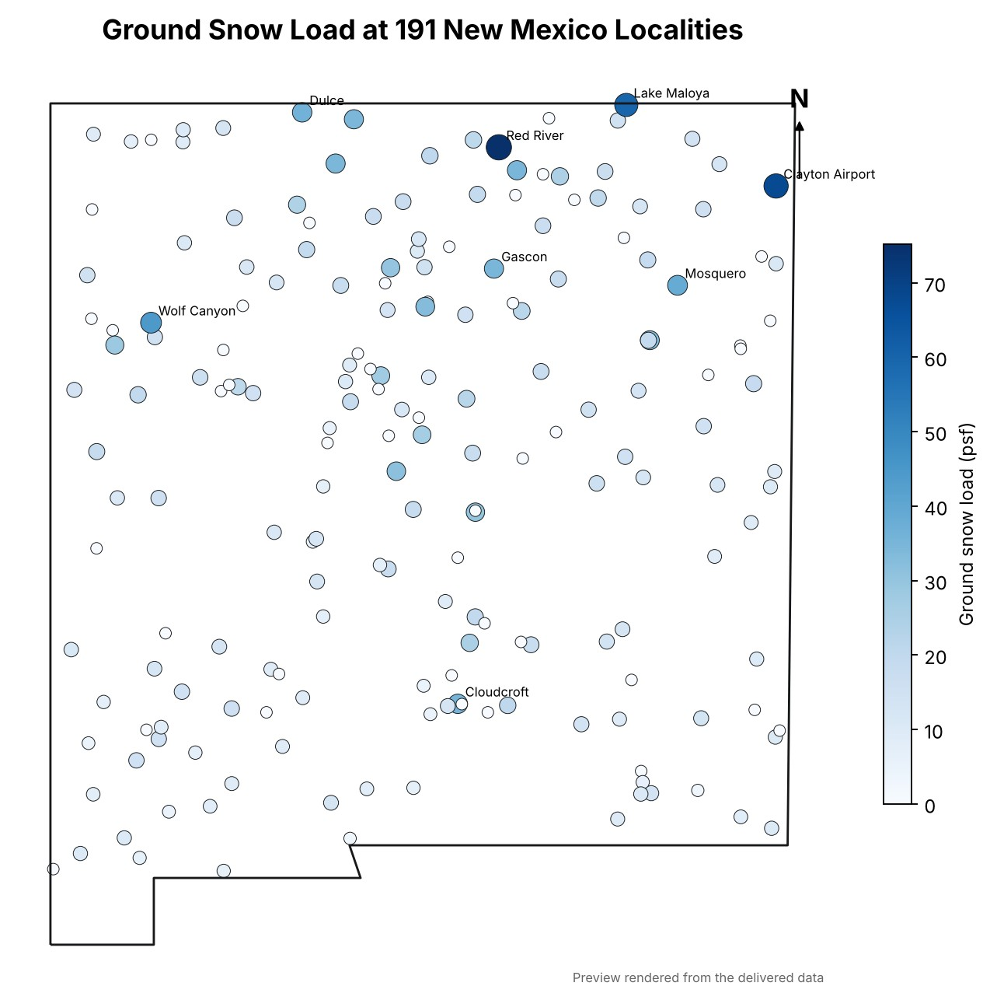

# New Mexico Cities Snow-Load & Elevation KMZ

**Category:** Cartography & Thematic Mapping &nbsp;·&nbsp; **Location:** New Mexico, USA &nbsp;·&nbsp; **Year:** 2026  
**Client:** Upwork client, USA  
**Tools & data:** QGIS, Google Earth, KML/KMZ

*Figure 1. Ground snow load at 191 New Mexico localities (preview rendered from the delivered KMZ)*

## Overview
Built a Google Earth KMZ of 191 New Mexico localities across 34 counties, carrying ground snow-load and elevation attributes from a published snow-load table.

## Challenge
Turn a printed table of ground snow loads for New Mexico localities into a Google Earth file the client could explore.

## Data
- Ground snow-load table for New Mexico localities (table pages 4–8)
- Locality locations and elevations

## Approach
1. Extracted the snow-load table
2. Located each locality and attached snow load, elevation and county
3. Exported a styled KMZ with pop-up attributes for Google Earth

## Results
- 191 localities across 34 counties, with ground snow loads from 0 to 75.2 psf
- The highest loads are in the northern mountains (for example Red River, Lake Maloya, Dulce)

## Deliverables

- Final_City_with_Snow_and_Elevation.kmz
- New Mexico Snowload Extract[4-8].pdf

*Map preview rendered from the delivered KMZ.*

---
[← All projects](../../README.md) · [Portfolio website](https://abdul-haleem-khan-rs-gis.github.io/Geospatial_Portfolio/projects/new-mexico-snow-load-kmz.html)
