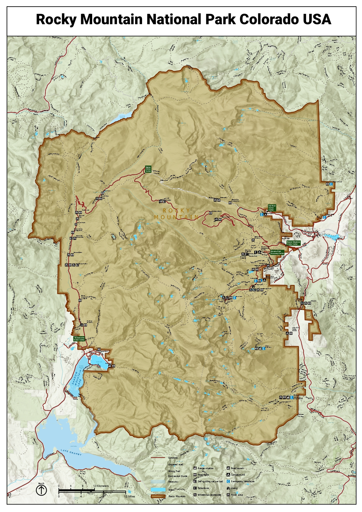

# U.S. National Park Service Map Redesign

**Category:** Cartography & Thematic Mapping &nbsp;·&nbsp; **Location:** Rocky Mountain National Park, USA &nbsp;·&nbsp; **Year:** 2025  
**Client:** Upwork client  
**Tools & data:** ArcGIS Pro, NPS open data

*Figure 1. Redesigned map of Rocky Mountain National Park, Colorado*

## Overview
Replicated and improved an NPS park map, refining the colour scheme, symbology and labelling for a clearer, more usable map.

## Challenge
Replicate a National Park Service map of Rocky Mountain National Park and improve its clarity for visitors without losing its familiar look.

## Data
- NPS open data (public-nps.opendata.arcgis.com) and the NPS ArcGIS Online group supplied by the client
- Terrain for elevation shading

## Approach
1. Rebuilt the park map in ArcGIS Pro from NPS open data
2. Colour: a more vibrant but balanced palette (rich greens for forest, lighter tones for meadows and water) and clearer elevation shading
3. Symbols: simplified, recognisable icons for trailheads and points of interest with a subtle shadow; solid, dashed and dotted lines for paved roads, trails and minor paths
4. Labels: larger sans-serif type for major features, italics for trails and elevations, contour labels following terrain, no overlaps

## Results
- Colour: a brighter but balanced palette separates dense forest, meadows and water, and clearer elevation shading makes terrain readable at a glance
- Symbols: simplified icons with a subtle shadow stay visible over forest and rugged terrain; solid, dashed and dotted lines separate paved roads, trails and minor paths
- Labels: hierarchy by type size and style, contour labels following the terrain, and no text over important features
- Finished map plus a written report recommending these changes for future NPS maps

## Deliverables

- Cartographic Improvements for the Next Generation of NPS Maps Report.pdf

---
[← All projects](../../README.md) · [Portfolio website](https://abdul-haleem-khan-rs-gis.github.io/Geospatial_Portfolio/projects/nps-map-redesign.html)
