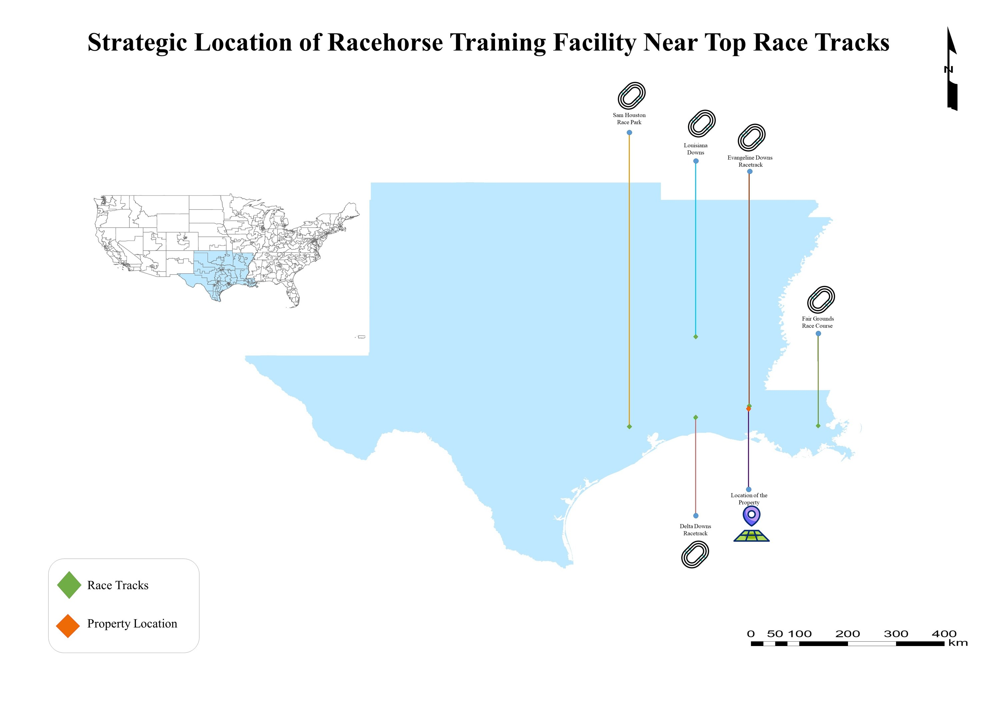

# Racehorse Training Facility Location Map

**Category:** Cartography & Thematic Mapping &nbsp;·&nbsp; **Location:** Texas and the U.S. Gulf states &nbsp;·&nbsp; **Year:** 2024  
**Client:** Upwork client, USA  
**Tools & data:** ArcGIS Pro

*Figure 1. Strategic location of the training facility relative to the top race tracks*

## Overview
Strategic location graphic showing a racehorse training facility relative to the top race tracks.

## Challenge
Create a marketing graphic that shows at a glance how close a racehorse training property is to the region's top race tracks.

## Data
- Property location and race-track locations supplied by the client
- U.S. state boundaries

## Approach
1. Plotted the property and tracks with distinct symbols
2. Added leader lines and labels to each track
3. Exported high-resolution PNG, JPG and PDF

## Results
- High-resolution location graphic (20 MB PNG and 16 MB PDF) ready for marketing

*Also delivered to the client (not published here):*

- Strategic Location of Racehorse Training Facility Near Top Race Tracks.jpg
- Strategic Location of Racehorse Training Facility Near Top Race PNG.png

---
[← All projects](../../README.md) · [Portfolio website](https://abdul-haleem-khan-rs-gis.github.io/Geospatial_Portfolio/projects/racehorse-facility-location-map.html)
