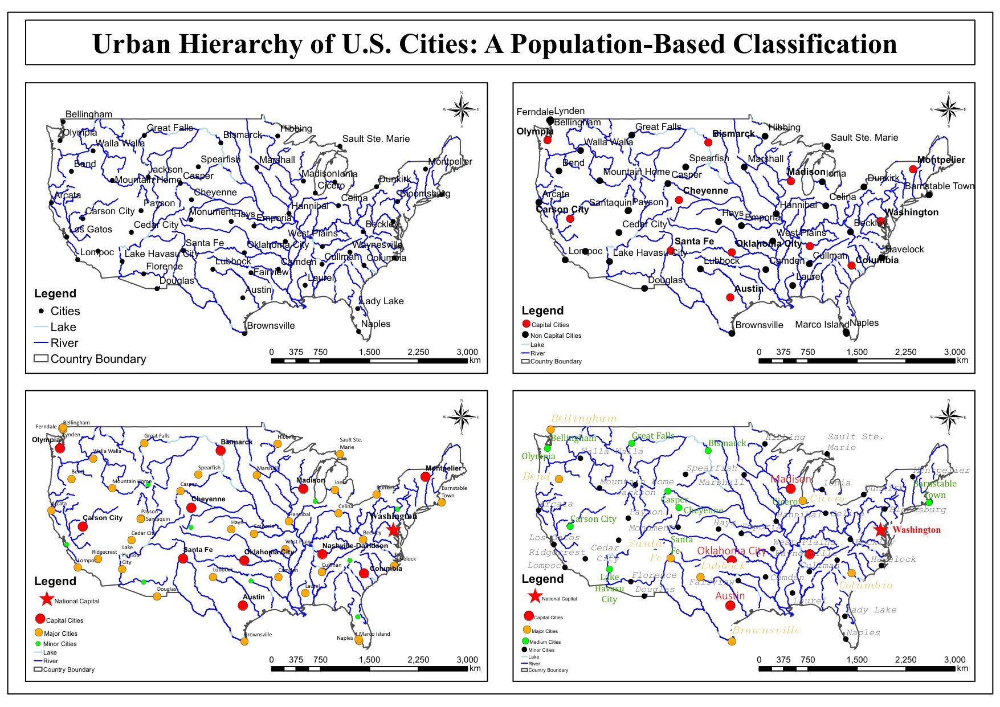
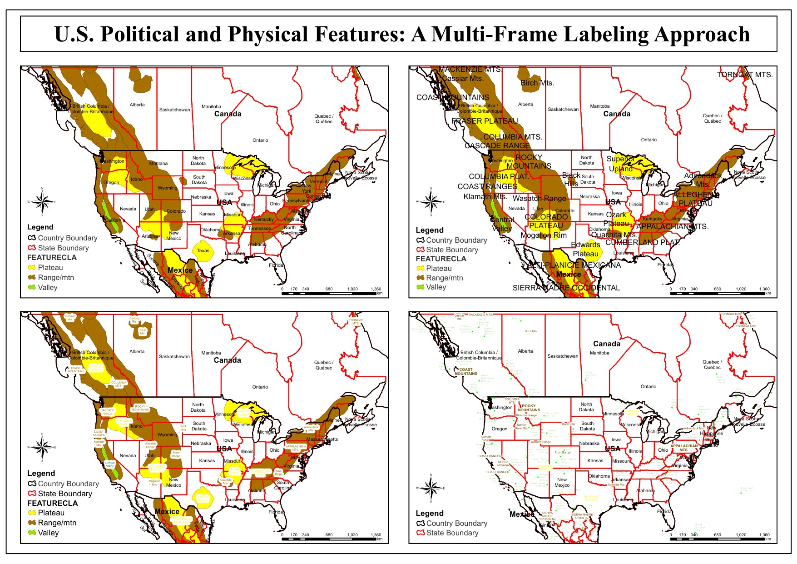
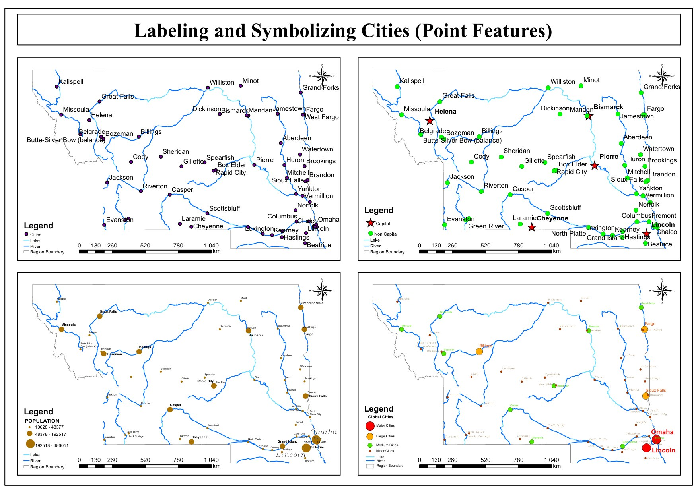
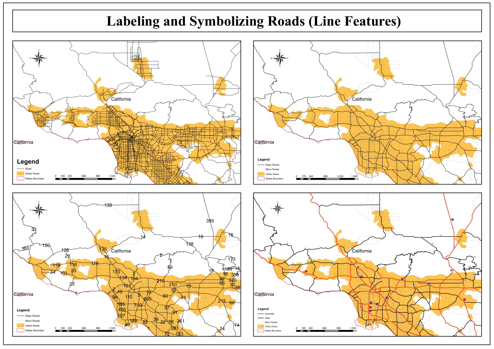

# Reference Mapping with Text, Icons & Labels

**Category:** Cartography & Thematic Mapping &nbsp;·&nbsp; **Location:** United States (national, Arizona and Colorado map panels) &nbsp;·&nbsp; **Year:** 2025  
**Client:** Upwork client  
**Tools & data:** ArcGIS Pro

*Figure 1. Urban hierarchy of U.S. cities: four labelling frames*

*Figure 2. U.S. political and physical features: multi-frame labelling*

*Figure 3. Labelling and symbolising cities (point features)*

*Figure 4. Labelling and symbolising roads (line features)*

## Overview
Two cartography projects on label placement, symbol design and icon use for reference maps.

## Challenge
Find the clearest way to label and symbolise cities, rivers, lakes, political and physical areas, and roads on reference maps.

## Data
- U.S. cities, states, rivers, lakes, mountain ranges and road networks

## Approach
1. Built four map panels, each with three or four frames that progressively improve labelling
2. Cities: from identical symbols to a four-tier hierarchy by population and capital status
3. Water: curved labels that follow rivers and better lake label placement
4. Political and physical areas: label colours matched to features, letter spacing, uppercase mountain ranges and spot elevations
5. Roads: road hierarchy, highway shields instead of text, and controlled label density

## Results
- The four-tier city hierarchy balances detail and readability best
- Curved river labels and highway shields gave the clearest maps
- Two illustrated reports explain the best frame in each panel

## Deliverables

- Report on Effective Reference Mapping Using Text and Icons_merged.pdf
- Labeling and Symbolizing Project.pdf

---
[← All projects](../../README.md) · [Portfolio website](https://abdul-haleem-khan-rs-gis.github.io/Geospatial_Portfolio/projects/reference-mapping-text-icons.html)
