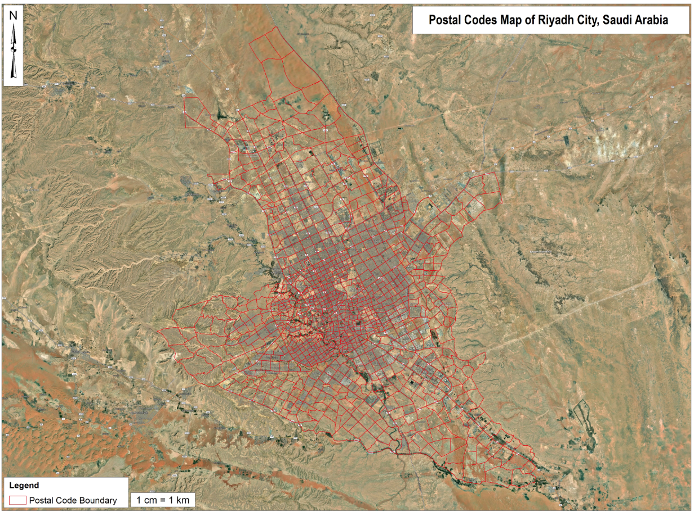

# Riyadh Postal Code Boundaries (GeoJSON)

**Category:** Cartography & Thematic Mapping &nbsp;·&nbsp; **Location:** Riyadh, Saudi Arabia &nbsp;·&nbsp; **Year:** 2025  
**Client:** Upwork client, Saudi Arabia  
**Tools & data:** QGIS, ArcGIS Pro, GeoJSON

## Overview
Delineated Riyadh postal code boundaries and delivered them as GeoJSON ready for GIS platforms and web maps.

## Approach
1. Reference boundary sources
2. Delineate postcode polygons
3. Attribute + topology check
4. GeoJSON export

## Result
Postal-code polygon dataset (GeoJSON) and map.

## Deliverables

- Riyadh_ZIP.zip

---
[← All projects](../../README.md) · [Portfolio website](https://abdul-haleem-khan-rs-gis.github.io/Geospatial_Portfolio/projects/riyadh-postcode-map.html)
