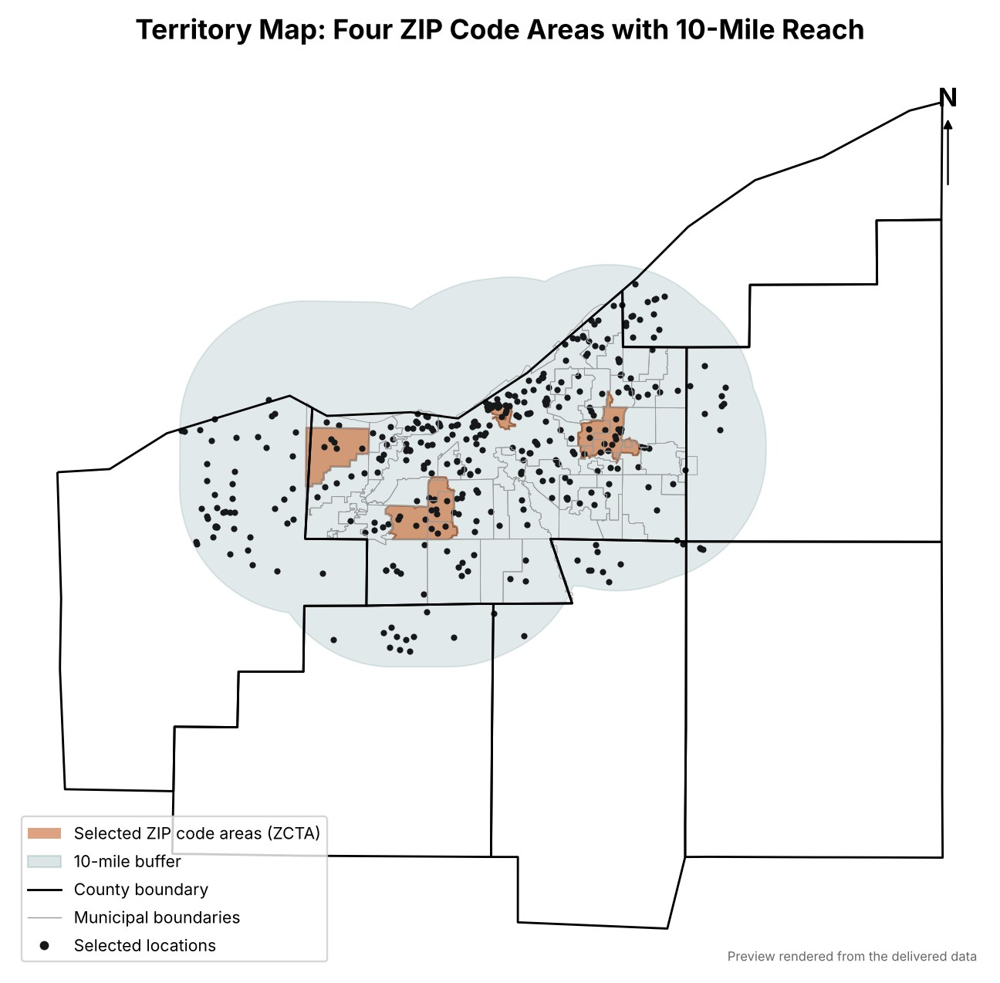

# Sales Territory Map from ZIP Codes

**Category:** Cartography & Thematic Mapping &nbsp;·&nbsp; **Location:** Cuyahoga County (Cleveland area), Ohio, USA &nbsp;·&nbsp; **Year:** 2024  
**Client:** Upwork client, USA  
**Tools & data:** ArcGIS Pro, Census ZCTA, OpenStreetMap

*Figure 1. Four ZIP code areas with a 10-mile reach and selected schools (preview rendered from the delivered data)*

## Overview
Built a territory around four ZIP code areas in the Cleveland area (44115, 44122, 44130, 44145) with a 10-mile reach, added county, municipal and school-district boundaries, and selected the schools and public facilities inside it from OpenStreetMap.

## Challenge
Define a service territory around four ZIP codes and find the schools within reach.

## Data
- Census 2020 ZCTA boundaries for 44115, 44122, 44130 and 44145
- Boundaries of seven counties (Cuyahoga, Lorain, Medina, Summit, Portage, Geauga, Lake), 59 Cuyahoga municipalities and 31 school districts
- 53,130 OpenStreetMap points of 187 types for the area

## Approach
1. Selected the four ZCTAs and created a centroid point for each
2. Built a 10-mile buffer around them and dissolved it into one territory (about 2,900 km²)
3. Added county, municipal and school-district boundaries for context
4. Filtered the 53,130 OpenStreetMap points down to schools and public facilities inside the territory
5. Packaged all layers with the map

## Results
- 371 facilities selected inside the territory: 236 schools, 48 post offices, 44 social facilities, 30 police stations, 11 hospitals, 1 university and 1 public building
- The territory spans parts of seven counties around Cleveland, not just Cuyahoga
- Every layer was delivered as a shapefile so the client can redraw or extend the territory

## Deliverables

- Todd Project Data.rar

*Map preview rendered from the delivered shapefiles.*

---
[← All projects](../../README.md) · [Portfolio website](https://abdul-haleem-khan-rs-gis.github.io/Geospatial_Portfolio/projects/zip-code-territory-map.html)
