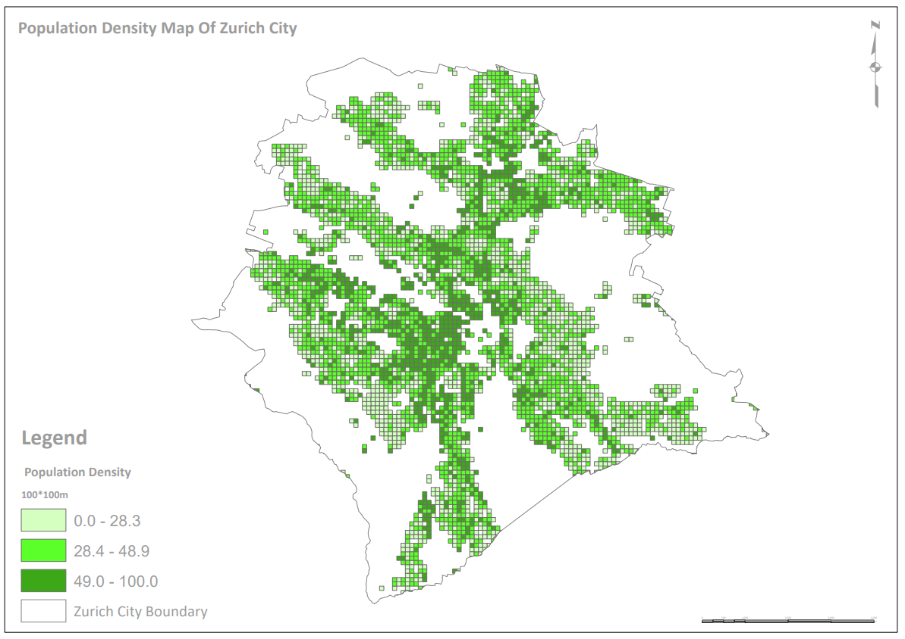

# Zurich Population Density, Ages 25–45

**Category:** Cartography & Thematic Mapping &nbsp;·&nbsp; **Location:** Zurich, Switzerland &nbsp;·&nbsp; **Year:** 2023  
**Client:** Upwork client, Switzerland  
**Tools & data:** ArcGIS

## Overview
Commissioned demographic map of Zurich showing the density of residents aged 25 to 45 on a 100 m grid.

## Approach
1. Demographic data by district
2. Density calculation
3. Thematic classification
4. Layout

## Result
Print-ready population density map.

---
[← All projects](../../README.md) · [Portfolio website](https://abdul-haleem-khan-rs-gis.github.io/Geospatial_Portfolio/projects/zurich-population-density.html)
