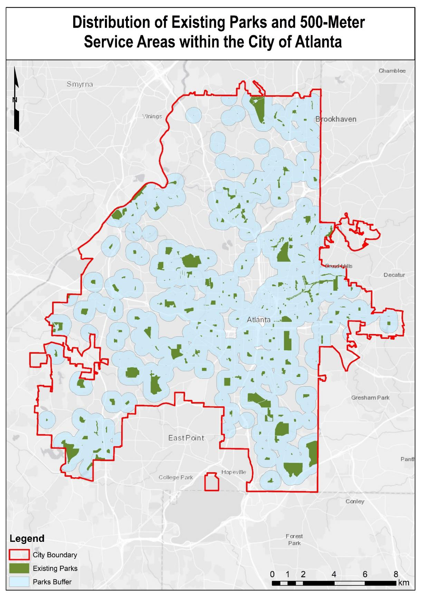
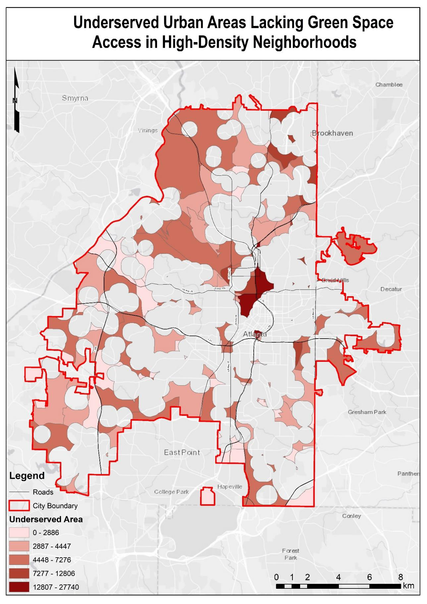
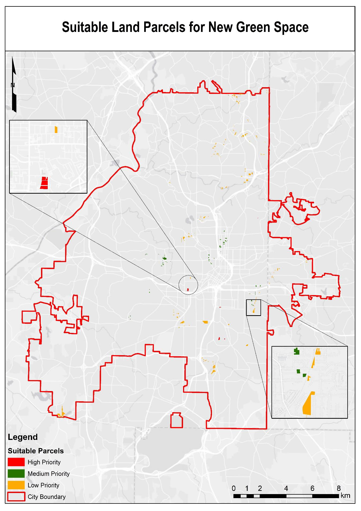

# Site Suitability for Urban Green Space: Atlanta

**Category:** Urban GIS & Site Suitability &nbsp;·&nbsp; **Location:** Atlanta, Georgia, USA &nbsp;·&nbsp; **Year:** 2025  
**Client:** Upwork client, USA (5.0★)  
**Tools & data:** ArcGIS 10.8, 2020 U.S. Census, Buffer & overlay analysis

*Figure 1. Existing parks and 500 m service areas*

*Figure 2. Population density by census tract (2020 Census)*

*Figure 3. Underserved high-density areas without green-space access*

*Figure 4. Suitable parcels for new green space by priority*

## Overview
GIS site-suitability study for new urban green space in Atlanta, combining park access, population density and available parcels.

## Challenge
Southern and western Atlanta have limited access to public parks. The study set out to find which neighbourhoods are underserved and which vacant parcels could become new green space.

## Data
- Parks: Atlanta GIS Hub
- 2020 Census tracts and population: U.S. Census Bureau
- Vacant parcels: Atlanta Open Data Portal (City Assessor)
- Roads: TIGER/Line (RTTYP functional class)
- City boundary: City of Atlanta (about 352 km²)
- Projection: NAD 1983 StatePlane Georgia West FIPS 1002 (feet)

## Approach
1. Re-projected all layers and clipped them to the city limit
2. Created 500 m walking buffers around existing parks
3. Calculated population density per tract and flagged tracts above 5,000 people/km²
4. Erased the park buffers from the city to find areas more than 500 m from a park
5. Intersected the underserved areas with high-density tracts to get priority zones
6. Selected vacant parcels in the priority zones larger than 1,000 m²
7. Removed parcels within 100 m of major roads (interstate, U.S. and state routes)
8. Ranked the remaining parcels as high, medium or low priority

## Results
- Several neighbourhoods, especially in Southeast Atlanta, have no green space within 500 m
- Many underserved areas are tracts above 5,000 people/km², confirming spatial inequity
- Of 6,000+ vacant parcels screened, 37 met every criterion (location, size, accessibility)
- Recommended ground-truthing the top parcels, stakeholder consultation and a full MCDM model in future

## Deliverables

- Distribution of Existing Parks and 500-Meter.pdf
- Population Density by Census Tract in Atlanta, Georgia (2020 Census Data).pdf
- Underserved Urban Areas Lacking Green Space.pdf
- Suitable Land Parcels for New Green Space.pdf
- A GIS-Based Site Suitability Analysis for Urban Green Spaces in Atlanta, Georgia.pdf

---
[← All projects](../../README.md) · [Portfolio website](https://abdul-haleem-khan-rs-gis.github.io/Geospatial_Portfolio/projects/atlanta-green-space-suitability.html)
