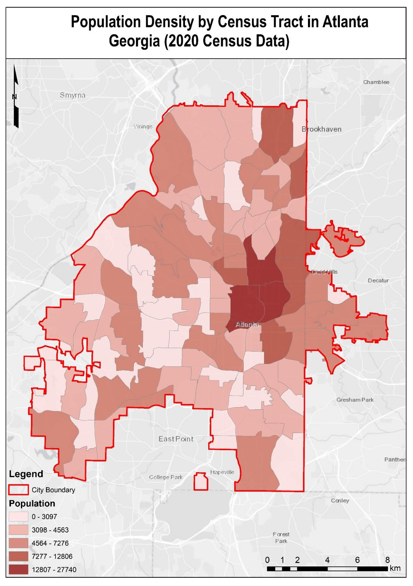

# Site Suitability for Urban Green Space: Atlanta

**Category:** Urban GIS & Site Suitability &nbsp;·&nbsp; **Location:** Atlanta, Georgia, USA &nbsp;·&nbsp; **Year:** 2025  
**Client:** Upwork client, USA (5.0★)  
**Tools & data:** ArcGIS Pro, 2020 U.S. Census, Buffer analysis

## Overview
GIS site-suitability study for new urban green space in Atlanta, combining park access, population density and available parcels.

## Approach
1. Existing parks + 500 m service buffers
2. 2020 Census population density by tract
3. Underserved-area overlay
4. Suitable parcel selection + report

## Result
Several neighbourhoods, especially in Southeast Atlanta, had no green space within 500 m, and many of them were tracts above 5,000 people/km². Of 6,000+ vacant parcels screened, 37 met every criterion (location, size, accessibility) and were ranked high, medium or low priority. Delivered as four large-format maps and a full report.

## Deliverables

- Distribution of Existing Parks and 500-Meter.pdf
- Population Density by Census Tract in Atlanta, Georgia (2020 Census Data).pdf
- Underserved Urban Areas Lacking Green Space.pdf
- Suitable Land Parcels for New Green Space.pdf
- A GIS-Based Site Suitability Analysis for Urban Green Spaces in Atlanta, Georgia.pdf

---
[← All projects](../../README.md) · [Portfolio website](https://abdul-haleem-khan-rs-gis.github.io/Geospatial_Portfolio/projects/atlanta-green-space-suitability.html)
