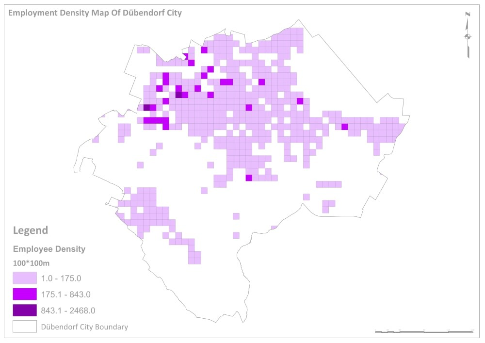

# Employment Density on a 100 m Grid: Dübendorf

**Category:** Urban GIS & Site Suitability &nbsp;·&nbsp; **Location:** Dübendorf, Switzerland &nbsp;·&nbsp; **Year:** 2024  
**Client:** Upwork client, Switzerland  
**Tools & data:** ArcGIS, QGIS, Swiss 100 m grid

## Overview
Employment density map of Dübendorf, showing the number of employees in each 100 m × 100 m grid cell across the city.

## Approach
1. Employment counts per 100 m grid cell
2. Clip to the city boundary
3. Classify into three density classes
4. Layout

## Result
Grid map in three classes (1–175, 175–843 and 843–2,468 employees per cell) that shows the main employment clusters in the north and centre of the city.

## Deliverables

- Employment Density Map Of Dübendorf City.pdf

---
[← All projects](../../README.md) · [Portfolio website](https://abdul-haleem-khan-rs-gis.github.io/Geospatial_Portfolio/projects/dubendorf-employment-density.html)
