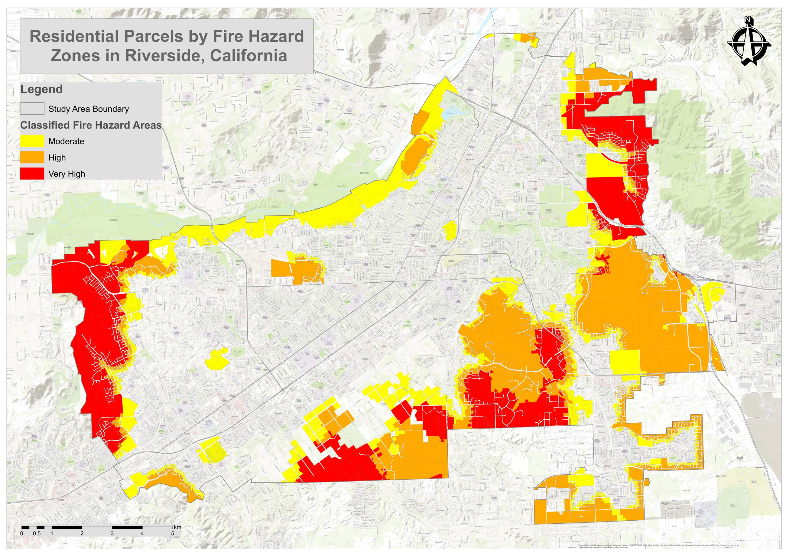
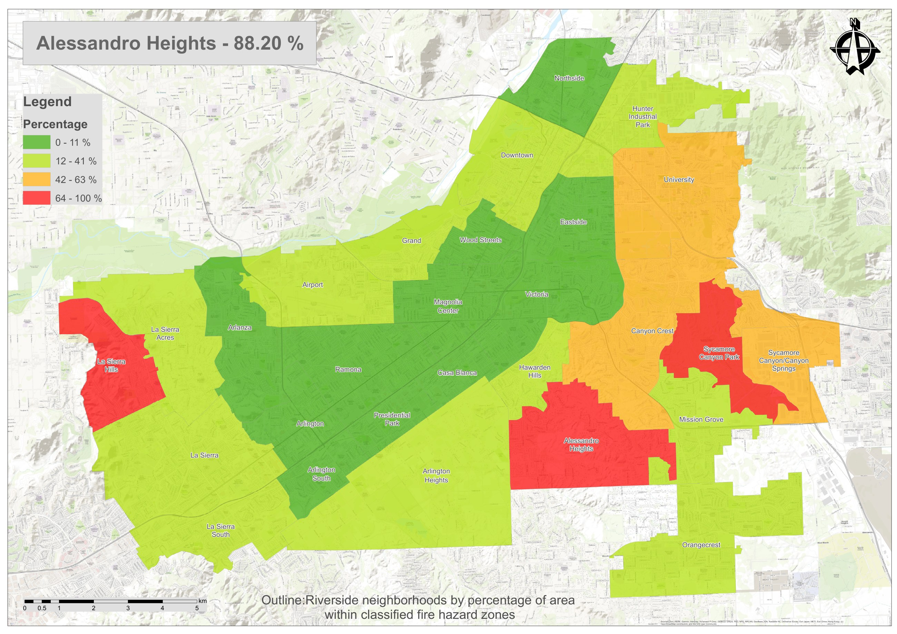

# Residential Parcels by Fire Hazard Zone: Riverside

**Category:** Urban GIS & Site Suitability &nbsp;·&nbsp; **Location:** Riverside, California, USA &nbsp;·&nbsp; **Year:** 2024  
**Client:** Practice study  
**Tools & data:** ArcGIS Pro

> Practice study. Course and client details are omitted.

*Figure 1. Residential parcels by fire hazard zone in Riverside, California*

*Figure 2. Riverside neighbourhoods by share of area within classified fire hazard zones; Alessandro Heights 88.20%*

## Overview
Overlay of residential parcels with fire hazard severity zones in Riverside, including a neighbourhood case study (Alessandro Heights).

## Challenge
Identify residential parcels in Riverside that fall within classified fire hazard severity zones.

## Data
- Riverside residential parcels
- Fire hazard severity zones (moderate, high, very high)

## Approach
1. Overlaid parcels with the hazard zones
2. Summarised parcels by zone
3. Calculated, for every Riverside neighbourhood, the share of its area inside classified fire hazard zones, and mapped it in four classes (0–11%, 12–41%, 42–63%, 64–100%)
4. Neighbourhood case study of Alessandro Heights

## Results
- Very-high hazard zones run along the city's western and southern edges next to open land
- Alessandro Heights has the highest exposure: 88.2% of its area lies in classified fire hazard zones
- La Sierra Hills and Sycamore Canyon Park are also in the highest class (64–100%), and University, Canyon Crest and Sycamore Canyon/Canyon Springs fall in the 42–63% class; the central neighbourhoods are mostly below 11%

## Deliverables

- Residential Parcels by Fire Hazard Zone in Riverside.rar
- Riverside neighbourhoods by share of area in fire hazard zones.pdf

---
[← All projects](../../README.md) · [Portfolio website](https://abdul-haleem-khan-rs-gis.github.io/Geospatial_Portfolio/projects/riverside-fire-hazard-parcels.html)
