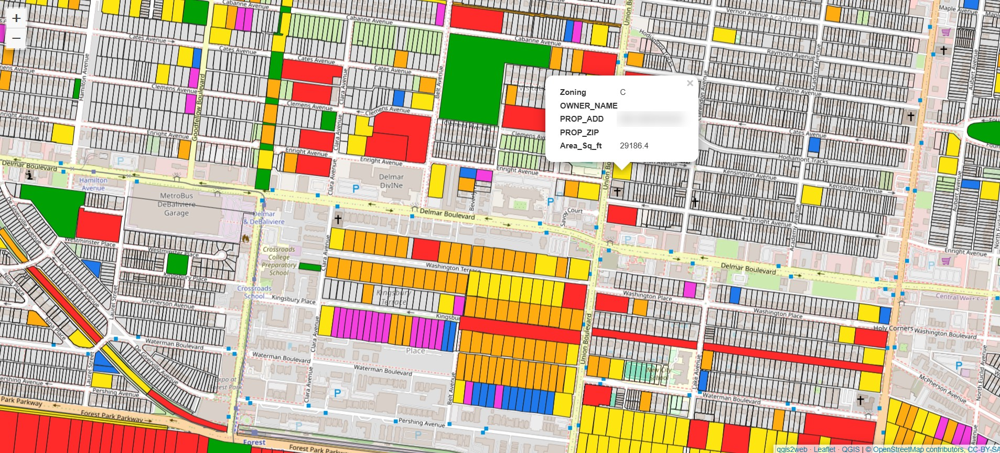
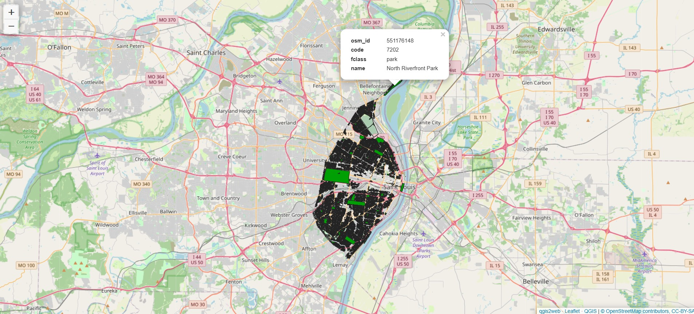

# Real-Estate Parcel Screening: St. Louis (Interactive Web Map)

**Category:** Urban GIS & Site Suitability &nbsp;·&nbsp; **Location:** St. Louis, Missouri, USA &nbsp;·&nbsp; **Year:** 2025  
**Client:** Upwork client, USA (real-estate investor)  
**Tools & data:** QGIS, qgis2web, Leaflet, OpenStreetMap, Parcel & zoning data

*Figure 1. Parcels colour-coded by lot size around Delmar Boulevard, with a parcel pop-up (address hidden here)*

*Figure 2. City-wide view of the parcel layer with parks in green and a park pop-up from OpenStreetMap*

## Overview
Interactive web maps that screen St. Louis residential parcels by lot size and building size, colour-coding the parcels that fit a real-estate investor's buying criteria.

## Challenge
A real-estate investor needed to see at a glance which residential parcels in St. Louis fit their buying criteria: lots in specific size ranges, and in a second map only those lots that also have a 3,000–6,000 sq ft building. Parks had to stand out, while commercial, school and city-owned parcels had to be left blank. The client asked me to find all the data myself.

## Data
- Parcel polygons with zoning, property address, ZIP and lot area (sq ft)
- Building footprints / structure size for the lot-and-structure map
- Parks from OpenStreetMap (land-use class "park")
- OpenStreetMap basemap

## Approach
1. Sourced the parcel, zoning and building data, then joined attributes and calculated lot area in square feet
2. Filtered to residential parcels; commercial parcels, schools and city-owned land were kept but left without fill
3. Classified lot size into the client's bands: under 13,000 sq ft no colour; 13,000–15,500 blue; 15,501–17,500 purple; 17,501–21,500 orange; 21,501–43,500 yellow; 43,501–200,000 red; over 200,000 no colour
4. Added all parks in green as a separate layer
5. For the second map, kept the lot-size colours only where the parcel's building is 3,000–6,000 sq ft; parcels with smaller or larger structures stay uncoloured
6. Set up pop-ups showing zoning, owner, property address, ZIP and lot area, so the client can click any parcel
7. Exported the QGIS project to an interactive Leaflet web map with qgis2web and hosted it for the client

## Results
- City-wide interactive map: zoom from the whole city down to individual lots on an OpenStreetMap base
- Colour classes make larger lots immediately visible, for example blocks of orange and yellow lots south of Delmar Boulevard
- Every parcel can be clicked for its zoning, address and exact lot area (for example a commercial parcel of 29,186 sq ft)
- Parks such as Forest Park and North Riverfront Park are shown in green for context

## Deliverables

- Interactive web map (shared privately with the client)

*The live map link is confidential and is not published here.*

---
[← All projects](../../README.md) · [Portfolio website](https://abdul-haleem-khan-rs-gis.github.io/Geospatial_Portfolio/projects/st-louis-parcel-criteria-map.html)
