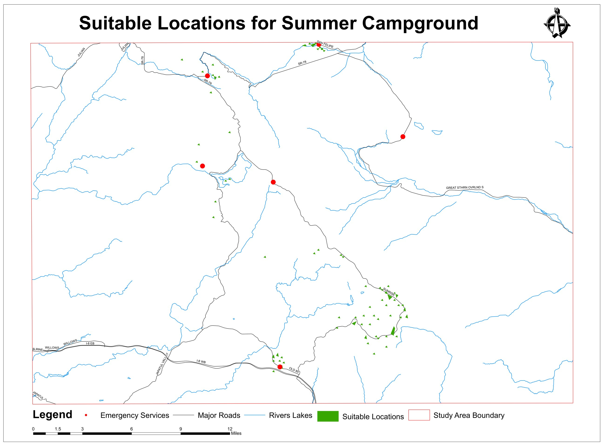

# Suitable Locations for a Summer Campground

**Category:** Urban GIS & Site Suitability &nbsp;·&nbsp; **Location:** Study area, USA &nbsp;·&nbsp; **Year:** 2024  
**Client:** Practice study  
**Tools & data:** ArcGIS Pro, DEM, Weighted overlay

> Practice study. Course and client details are omitted.

*Figure 1. Suitable locations for a summer campground*

## Overview
Raster suitability model combining relief and other criteria to find suitable campground sites.

## Challenge
Find suitable sites for a summer campground that are close to water and roads but not too far from emergency services.

## Data
- Relief/DEM
- Rivers and lakes
- Major roads
- Emergency services
- Study-area boundary

## Approach
1. Derived slope and relief
2. Reclassified each criterion
3. Weighted overlay to find suitable cells
4. Mapped the suitable locations

## Results
- A small set of suitable locations near rivers and roads, mapped with emergency-service coverage

## Deliverables

- Suitable Locations for Summer Campground.pdf
- Relief Details.rar

---
[← All projects](../../README.md) · [Portfolio website](https://abdul-haleem-khan-rs-gis.github.io/Geospatial_Portfolio/projects/summer-campground-suitability.html)
