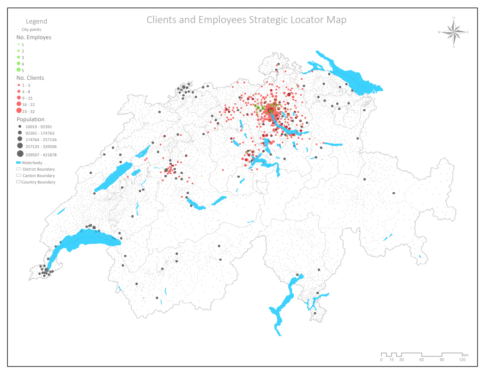

# Client & Employee Strategy Maps: Switzerland

**Category:** Urban GIS & Site Suitability &nbsp;·&nbsp; **Location:** Switzerland &nbsp;·&nbsp; **Year:** 2023–2025  
**Client:** Swiss service company (repeat client)  
**Tools & data:** ArcGIS, QGIS

*Figure 1. Clients and employees strategic locator map, by postal code*

## Overview
Strategy maps for a Swiss cleaning company: clients (red) and employees (green) by postal code, with circle size by count, over city population and water bodies, and a later postal-code map shaded by client count.

## Challenge
A Swiss cleaning company wanted to see where its clients and staff are, so it could plan service areas and recruitment.

## Data
- Client and employee address lists (Excel)
- Swiss postal-code points, district, canton and country boundaries
- City population (10,019 to 421,878) and water bodies

## Approach
1. Geocoded clients and employees and aggregated them by postal code
2. Sized client symbols in five classes (1 to 32 clients per postal code) and employee symbols from 1 to 5
3. Added city population circles, lakes and administrative boundaries for context

## Results
- Clients concentrate in and around Zurich, with smaller clusters around Lucerne and Bern
- Employees live mostly in the Zurich area, close to the main client cluster
- Large cities such as Geneva, Basel and Lausanne show few or no clients on the map

*Also delivered to the client (not published here):*

- 4Postalcode base Strategic Locator Map.pdf

---
[← All projects](../../README.md) · [Portfolio website](https://abdul-haleem-khan-rs-gis.github.io/Geospatial_Portfolio/projects/swiss-client-employee-strategy-maps.html)
