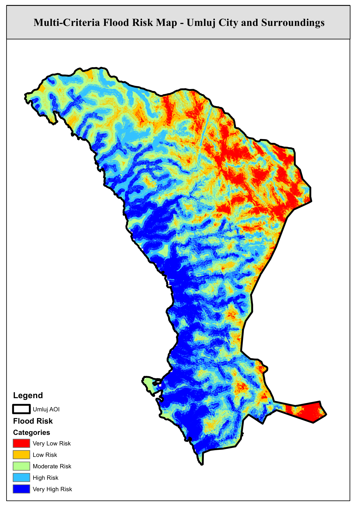

# Multi-Criteria Flood Risk Map: Umluj

**Category:** Urban GIS & Site Suitability &nbsp;·&nbsp; **Location:** Umluj, Saudi Arabia &nbsp;·&nbsp; **Year:** 2025  
**Client:** Sadeem International Company, Saudi Arabia (5.0★)  
**Tools & data:** ArcGIS Pro, MCDA, DEM

## Overview
Environmental assessment to choose sites for flood sensors: a multi-criteria flood risk map of Umluj city and surroundings.

## Approach
1. Study-area definition
2. Flood factors (terrain, drainage, land use)
3. Weighted overlay (MCDA)
4. Risk map + sensor siting

## Result
Flood risk map, study-area boundary comparison maps and project outline.

## Deliverables

- Multi-Criteria Flood Risk Map – Umluj City and Surroundings.pdf
- Compersion Map of Study Area Boundary and Without Boundary.pdf
- Project Outline.pdf

---
[← All projects](../../README.md) · [Portfolio website](https://abdul-haleem-khan-rs-gis.github.io/Geospatial_Portfolio/projects/umluj-flood-risk-mcda.html)
