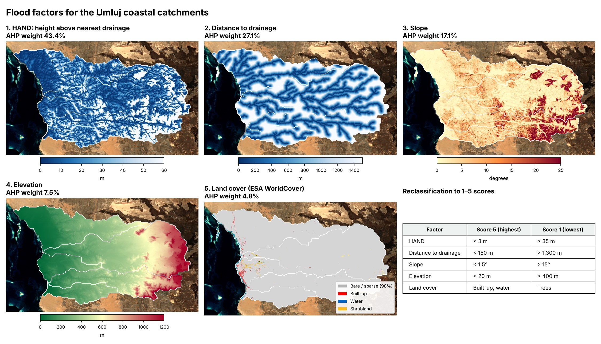
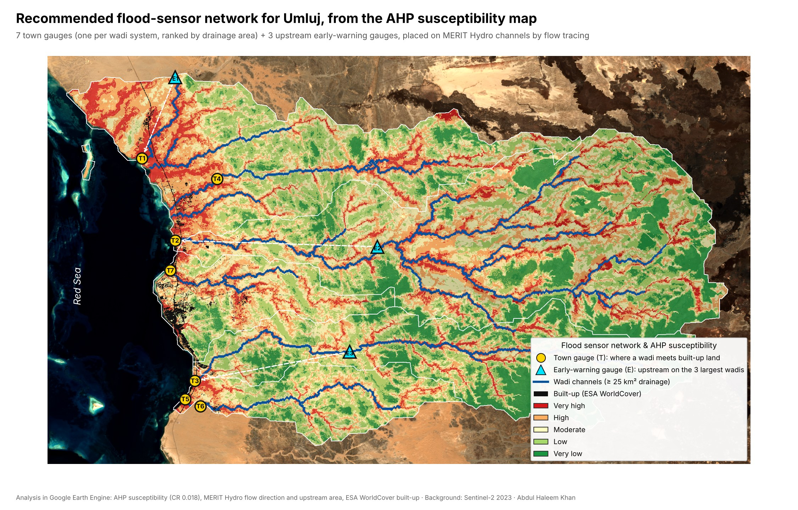
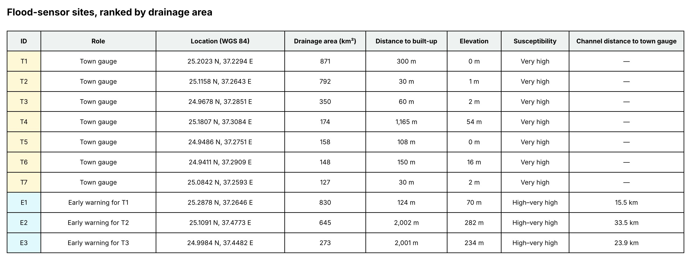

# Flood Susceptibility with AHP: Umluj Coastal Catchments (Google Earth Engine)

**Category:** Urban GIS & Site Suitability &nbsp;·&nbsp; **Location:** Umluj city and surroundings, Saudi Arabia &nbsp;·&nbsp; **Year:** 2025 project · AHP extension 2026  
**Client:** Based on my project for Sadeem International Company, Saudi Arabia (5.0★ review)  
**Tools & data:** Google Earth Engine (JavaScript), AHP, MCDA, MERIT Hydro HAND, Copernicus DEM, ESA WorldCover

*Figure 1. Flood susceptibility of the Umluj coastal catchments from the AHP weighted overlay*

*Figure 2. The five flood factors with their AHP weights, and the 1–5 reclassification rules*

*Figure 3. AHP pairwise comparison matrix with consistency check, and area by susceptibility class (AHP vs equal weights)*

*Figure 4. Sensitivity test: AHP weights vs equal weights*

*Figure 5. Recommended flood-sensor network: 7 town gauges and 3 upstream early-warning gauges on the AHP map*

*Figure 6. Sensor sites with coordinates, drainage area, distance to built-up land and channel distance*

## Overview
Flood susceptibility map of the Umluj coastal catchments built with the Analytic Hierarchy Process (AHP): five factors weighted by pairwise comparison (CR = 0.018), combined in Google Earth Engine from open global data, then used to site a 10-gauge flood-sensor network, the original goal of the project.

## Challenge
In 2025, Sadeem International Company asked me for an environmental assessment of Umluj city and its surroundings, to decide where to install flood sensors. That meant answering one question: where is flooding most likely? I delivered a multi-criteria flood risk map, rated 5.0★. In any weighted overlay, the weights drive the result, and sensor placement depends on them, so they need to be explained and defended. This extension rebuilds the analysis with the Analytic Hierarchy Process (AHP), so every weight comes from a documented pairwise comparison with a consistency check. The whole model runs in Google Earth Engine from open global data that anyone can reproduce.

## Data
- Study area: the five HydroSHEDS level-8 basins draining to the coast at and around Umluj (1,999 km²); the original client AOI file was not delivered, so a watershed boundary is used
- Copernicus GLO-30 DEM (30 m): elevation and slope
- MERIT Hydro (90 m): HAND (height above nearest drainage) and upstream area; channels draining at least 5 km²
- ESA WorldCover 2021 (10 m): land cover
- Sentinel-2 2023 composite as the map background

## Approach
1. Delineated the study area from HydroSHEDS level-8 basins, so it follows real catchments rather than an arbitrary box
2. Derived five flood factors: HAND, distance to drainage, slope, elevation and land cover
3. Reclassified each factor to a 1–5 susceptibility score with breaks set from its distribution in the study area (for example HAND under 3 m = 5, over 35 m = 1)
4. Built the AHP pairwise comparison matrix on Saaty's 1–9 scale and derived the weights: HAND 43.4%, distance to drainage 27.1%, slope 17.1%, elevation 7.5%, land cover 4.8%
5. Checked consistency: λmax 5.079, CI 0.020, CR 0.018, well below the 0.10 limit
6. Combined the factors in a weighted overlay and classified the index into five classes, from very low to very high
7. Ran a sensitivity test with equal weights and measured built-up exposure with WorldCover
8. Sited flood sensors: candidate cells on the main wadis in the high or very high class; one town gauge per wadi system where it meets built-up land, ranked by drainage area
9. Added upstream early-warning gauges on the three largest wadis, checked by tracing each candidate's flow path cell by cell on the MERIT Hydro flow-direction grid to make sure it drains to that wadi's town gauge
10. Exported the susceptibility rasters and the sensor sites (shapefile, GeoJSON, CSV)

## Results
- Very high susceptibility covers 238 km² (12%) and high 436 km² (22%), concentrated along the wadi network and the low coastal plain around Umluj
- 68% of built-up land in the catchments (10.9 of 16.1 km²) falls in the high or very high classes
- Sensitivity: AHP and equal weights give the same class for 71% of the area, but AHP identifies about 3× more very-high land (238 vs 75 km²) along the drainage lines, where flash floods actually run
- Recommended network: 10 sensors. 7 town gauges (T1–T7) where wadis draining 127–871 km² reach built-up land, plus 3 early-warning gauges (E1–E3) 15.5–33.5 km upstream along the channel on the three largest wadis
- Consistent with the original client map: wadi channels and the coastal plain are the highest-risk zones, and the elevated eastern ground is lowest

## Links

- [Open in the Earth Engine Code Editor](https://code.earthengine.google.com/a798305d9e3ebf798b8601c8bb0d61c3)
- [View the script on GitHub](https://github.com/Abdul-Haleem-Khan-RS-GIS/spatial-analysis-showcase/blob/main/03-Urban-GIS-and-Suitability/umluj-flood-susceptibility-ahp/code/umluj_flood_susceptibility_ahp.js)
- [See the original client project](https://abdul-haleem-khan-rs-gis.github.io/Geospatial_Portfolio/projects/umluj-flood-risk-mcda.html)

## Deliverables

- code/umluj_flood_susceptibility_ahp.js (full Earth Engine script)
- data/umluj_flood_sensor_sites.geojson and .csv (10 recommended sensor sites)
- Maps: susceptibility, factors, AHP matrix, sensitivity test, sensor network, site table

---
[← All projects](../../README.md) · [Portfolio website](https://abdul-haleem-khan-rs-gis.github.io/Geospatial_Portfolio/projects/umluj-flood-susceptibility-ahp.html)
