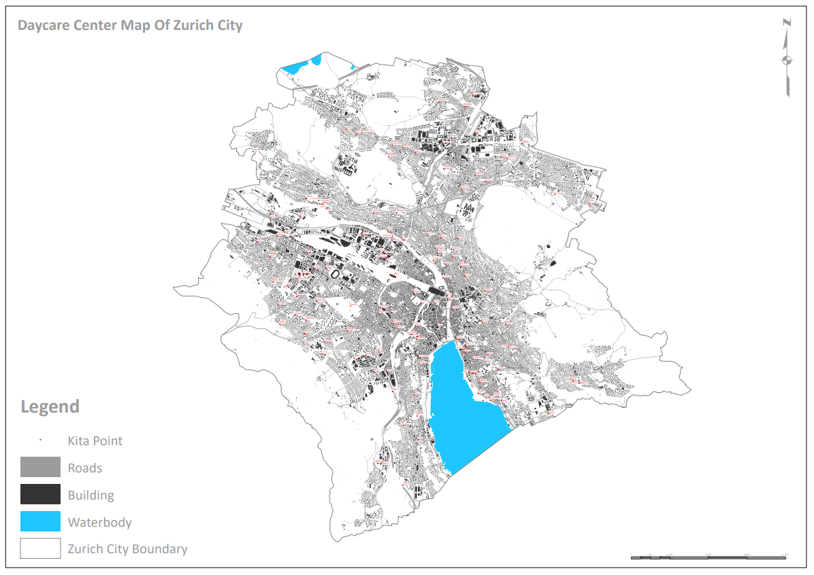

# Daycare Centres of Zurich

**Category:** Urban GIS & Site Suitability &nbsp;·&nbsp; **Location:** Zurich, Switzerland &nbsp;·&nbsp; **Year:** 2023  
**Client:** Upwork client, Switzerland  
**Tools & data:** ArcGIS

*Figure 1. Daycare centres (Kita) across the city of Zurich*

## Overview
Map of every daycare centre in the city of Zurich.

## Challenge
Give the client a single, clear map of every daycare centre (Kita) in the city of Zurich.

## Data
- Daycare (Kita) locations
- Buildings, roads and water bodies
- Zurich city boundary

## Approach
1. Geocoded and mapped every daycare centre
2. Added buildings, roads and water as context
3. Designed a print-ready city map

## Results
- City-wide daycare map delivered as a print-ready PDF

*Also delivered to the client (not published here):*

- Daycare Center Map Of Zurich City_compressed.pdf

---
[← All projects](../../README.md) · [Portfolio website](https://abdul-haleem-khan-rs-gis.github.io/Geospatial_Portfolio/projects/zurich-daycare-centres.html)
