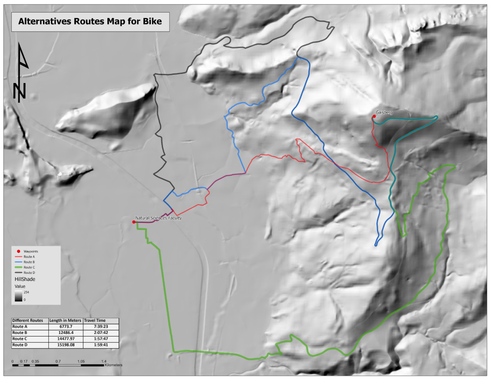

# Bike Route Network Analysis

**Category:** Network Analysis & Routing &nbsp;·&nbsp; **Location:** Mountainous region &nbsp;·&nbsp; **Year:** 2024  
**Client:** Upwork client (geomatics firm)  
**Tools & data:** ArcGIS Pro, Network Analyst, OpenStreetMap

## Overview
Used ArcGIS Pro and OpenStreetMap to calculate alternative routes for a bike tour where existing routing services fall short.

## Approach
1. OSM network dataset
2. Route solving in Network Analyst
3. Comparison with test-ride track
4. Findings

## Result
Calculated routes compared against reference data from a test ride, with conclusions for improving bike routing in mountainous terrain.

---
[← All projects](../../README.md) · [Portfolio website](https://abdul-haleem-khan-rs-gis.github.io/Geospatial_Portfolio/projects/bike-route-network-analysis.html)
