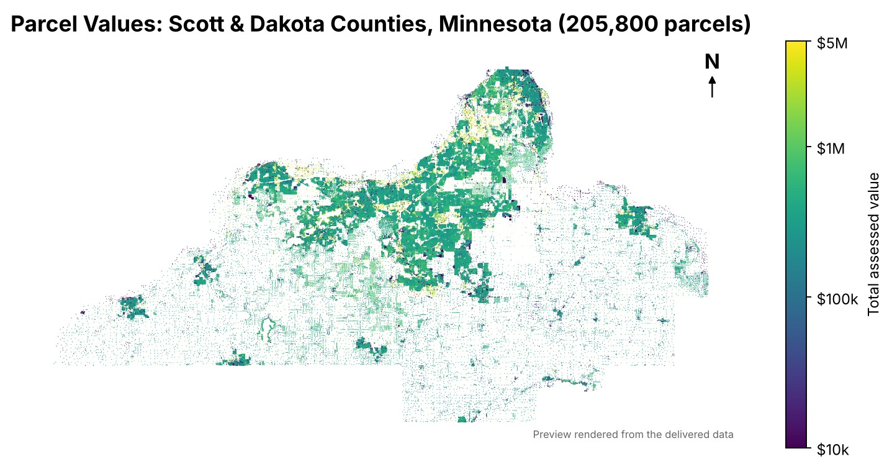

# County Dataset Integration: Scott & Dakota, MN

**Category:** GIS Data Engineering & CAD &nbsp;·&nbsp; **Location:** Scott and Dakota Counties, Minnesota, USA &nbsp;·&nbsp; **Year:** 2024  
**Client:** Upwork client, USA  
**Tools & data:** ArcGIS Pro

*Figure 1. Assessed parcel values in Scott and Dakota counties (preview rendered from the delivered data)*

## Overview
Combined county parcel, address and assessment datasets into one clean, consistent table for each of two Minnesota counties, with coordinates for every parcel.

## Challenge
Combine several county datasets into one consistent parcel table per county, with coordinates and assessed values.

## Data
- Scott County and Dakota County parcel, address and assessment data

## Approach
1. Matched schemas between sources
2. Merged and cleaned records
3. Added latitude and longitude for each parcel
4. Exported one table per county

## Results
- More than 205,000 parcels across Scott and Dakota counties mapped with assessed values
- Tables kept private because they include owners' names and addresses

*Map preview rendered from the delivered data.*

---
[← All projects](../../README.md) · [Portfolio website](https://abdul-haleem-khan-rs-gis.github.io/Geospatial_Portfolio/projects/minnesota-county-data-merge.html)
