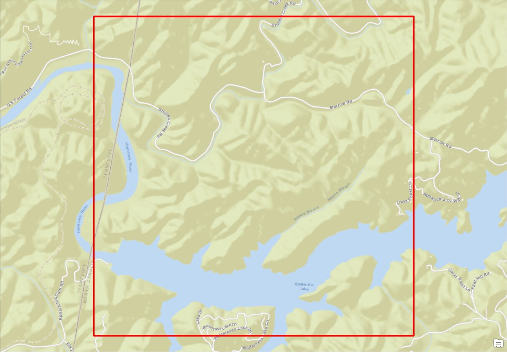
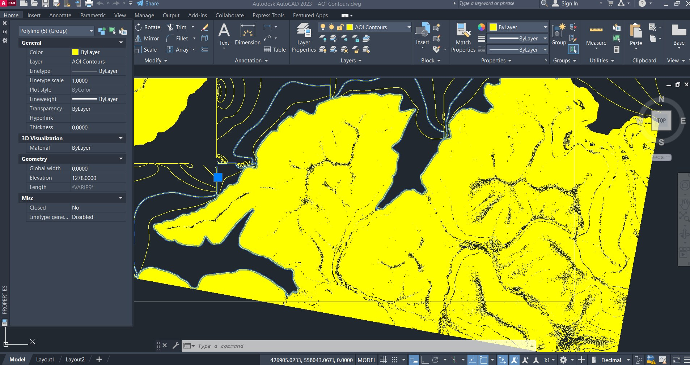

# 1-ft Contours to CAD, SHP & KMZ: Cherokee County, NC

**Category:** GIS Data Engineering & CAD &nbsp;·&nbsp; **Location:** Cherokee County, North Carolina, USA &nbsp;·&nbsp; **Year:** 2026  
**Client:** MBH Inc., USA (5.0★)  
**Tools & data:** ArcMap, AutoCAD 2023, Export to CAD, Shapefile, KMZ, DWG

*Figure 1. Area of interest (red box) over the Hiwassee River and Apalachia Lake, Cherokee County, NC*

*Figure 2. Clipped 1-ft contours with elevation labels and the contour attribute table (9,986 features)*

*Figure 3. Delivered DWG (AOI Contours.dwg) open in AutoCAD 2023, with each contour polyline carrying its elevation*

## Overview
Clipped NC OneMap 1-ft contours to a one-mile area of interest in Cherokee County, North Carolina, and delivered them as an AutoCAD DWG, an attributed shapefile and a KMZ for Google Earth.

## Challenge
A fixed-scope, pass/fail task for MBH Inc.: clip North Carolina 1-ft contours to a one-mile area near the Hiwassee River and Apalachia Lake and deliver working files for GIS, Google Earth and AutoCAD, or no payment. The full delivery came to more than 700 MB.

## Data
- NC OneMap 1-ft contours (from 3-ft DEMs) for Cherokee County, North Carolina, as vector contours and a raster contour layer
- Client's centre point, used to build a one-mile buffer and the area-of-interest box
- Esri World Street Map basemap for checking

## Approach
1. Plotted the client's centre point and built a one-mile buffer and an area-of-interest box around it
2. Clipped the contours to the AOI, keeping the elevation (Contour) and index-contour (Index) attributes
3. Checked contour continuity and elevation labels at large scale
4. Exported the clipped contours as a shapefile, as a KMZ for Google Earth and as an AutoCAD file with Export to CAD
5. Checked the DWG in AutoCAD 2023: contours sit on an AOI Contours layer as polylines carrying their elevation (for example 1,278 ft)
6. Documented the coordinate system and software in a text note

## Results
- 9,986 contour lines in the area of interest at a 1-ft interval, with every fifth foot flagged as an index contour
- Elevations run from about 1,277 ft near the lake shore to over 1,650 ft on the ridges
- Delivered as CAD (DWG), SHP and KMZ with a projection note, more than 700 MB in total; accepted and paid
- Noted that the dataset covers North Carolina only, so the part of the AOI in Tennessee has no contours
- Client review: “Abdul delivered exactly what we needed with a complex GIS to CAD conversion.”

*The delivered files are not published here because the package is more than 700 MB.*

---
[← All projects](../../README.md) · [Portfolio website](https://abdul-haleem-khan-rs-gis.github.io/Geospatial_Portfolio/projects/nc-contours-to-cad.html)
