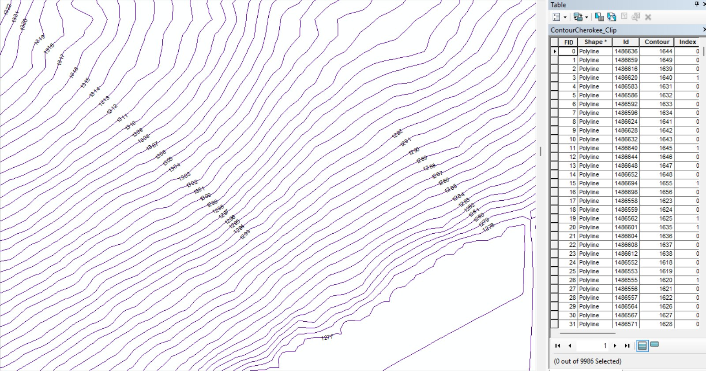

# 1-ft Contours to CAD (DWG + SHP)

**Category:** GIS Data Engineering & CAD &nbsp;·&nbsp; **Location:** Cherokee County, North Carolina, USA &nbsp;·&nbsp; **Year:** 2026  
**Client:** MBH Inc., USA (5.0★)  
**Tools & data:** ArcMap / ArcGIS Pro, Export to CAD, NC OneMap

*Figure 1. Area of interest (red box) over the Hiwassee River and Apalachia Lake, Cherokee County, NC*

*Figure 2. Clipped 1-ft contours with elevation labels and the contour attribute table (9,986 features)*

## Overview
Clipped NC OneMap 1-ft contours to a one-mile area of interest and exported them to both shapefile and AutoCAD DWG.

## Challenge
A fixed-scope, pass/fail task: clip North Carolina 1-ft contours to a one-mile area and deliver working DWG and shapefile versions, or no payment.

## Data
- NC OneMap 1-ft raster contours (from 3-ft DEMs), file geodatabase
- One-mile area of interest in Cherokee County, NC, around the Hiwassee River and Apalachia Lake, reaching the Tennessee state line
- Esri World Street Map basemap for checking

## Approach
1. Downloaded the contour FGDB and built the AOI box from the client's centre point and a one-mile buffer (adjusted to the client's marked area)
2. Clipped the contours to the AOI, keeping the elevation (Contour) and index-contour (Index) attributes
3. Exported to shapefile and to DWG with Export to CAD
4. Checked the labels at large scale, documented the coordinate system (State Plane, US feet) in a text note and confirmed that both files open

## Results
- 9,986 contour lines in the clipped area at a 1-ft interval, with every fifth foot flagged as an index contour
- Elevations run from about 1,277 ft near the lake shore to over 1,650 ft on the ridges
- Delivered SHP + DWG + projection note; accepted and paid
- Noted that the dataset covers North Carolina only, so the part of the AOI in Tennessee has no contours
- Client review: “Abdul delivered exactly what we needed with a complex GIS to CAD conversion.”

*Large files delivered via Google Drive.*

---
[← All projects](../../README.md) · [Portfolio website](https://abdul-haleem-khan-rs-gis.github.io/Geospatial_Portfolio/projects/nc-contours-to-cad.html)
