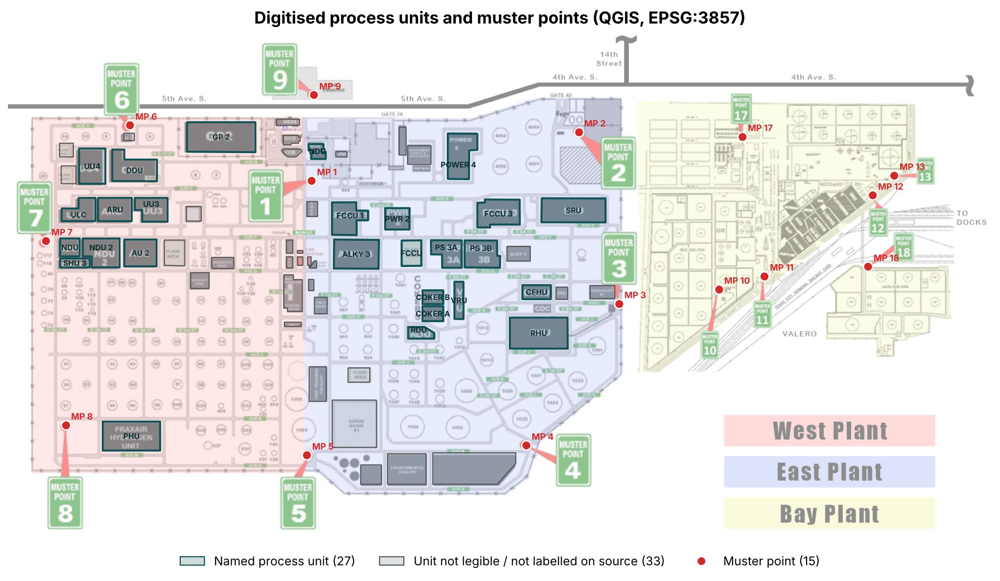
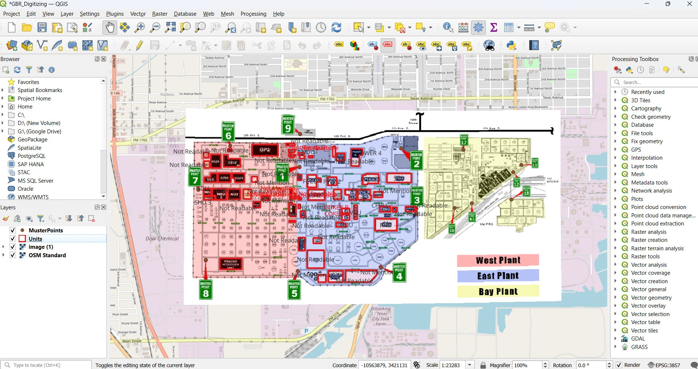
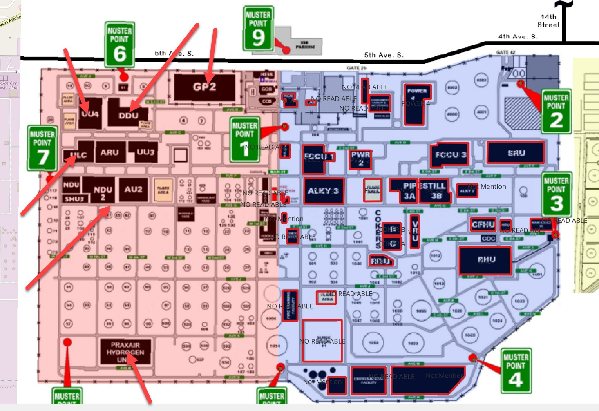

# Refinery Site Plan Digitisation: Process Units & Muster Points (QGIS)

**Category:** GIS Data Engineering & CAD &nbsp;·&nbsp; **Location:** Texas City, Texas, USA &nbsp;·&nbsp; **Year:** 2025  
**Client:** Valorian (5.0★)  
**Tools & data:** QGIS, Georeferencer, GeoPackage, Shapefile, EPSG:3857

*Figure 1. Digitised process units (named and unreadable) and muster points over the georeferenced site plan*

*Figure 2. The digitised layers over OpenStreetMap in QGIS*

*Figure 3. Working view: digitised unit outlines with their labels on the georeferenced plan*

## Overview
Urgent QGIS job: georeferenced a refinery site-plan image over OpenStreetMap and digitised 60 process-unit polygons and 15 emergency muster points with attributes.

## Challenge
The client had only a picture of a refinery's site plan, showing the West, East and Bay plants, process units and numbered emergency muster points. They needed it turned urgently into real GIS layers in the correct location, so the units and muster points could be used on a map with other data.

## Data
- Site-plan image supplied by the client (West Plant, East Plant and Bay Plant)
- OpenStreetMap basemap as the reference for georeferencing (streets such as 5th Ave. S. and 14th Street)
- Output projection: WGS 84 / Pseudo-Mercator (EPSG:3857)

## Approach
1. Georeferenced the site-plan image in QGIS against OpenStreetMap, matching road intersections and plant boundaries, and saved a world file
2. Created a polygon layer of process units with a Unit name field
3. Traced every unit building from the plan and entered its name (for example FCCU 1, ALKY 3, SRU, Coker A and B)
4. Labelled units whose name could not be read as "Not Readable" and units with no label as "Not Mention", so no guesses entered the data
5. Created a point layer for the muster points and recorded each muster-point number
6. Checked the geometry and labels against the source, then delivered the QGIS project, a GeoPackage and shapefiles

## Results
- 60 process-unit polygons digitised: 27 named, 25 marked Not Readable and 8 marked Not Mention
- 15 muster points captured (MP 1–13, 17 and 18) across the West, East and Bay plants
- All layers sit in their real location over OpenStreetMap, ready for further GIS analysis
- Delivered on an urgent deadline; the client left a 5.0★ review

## Deliverables

- Refinery_Digitisation_QGIS.zip (QGIS project, Units and MusterPoints shapefiles, gbr.gpkg, georeferenced site-plan image)

---
[← All projects](../../README.md) · [Portfolio website](https://abdul-haleem-khan-rs-gis.github.io/Geospatial_Portfolio/projects/qgis-polygon-point-digitisation.html)
