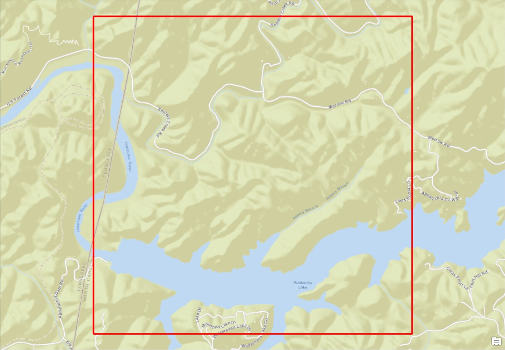
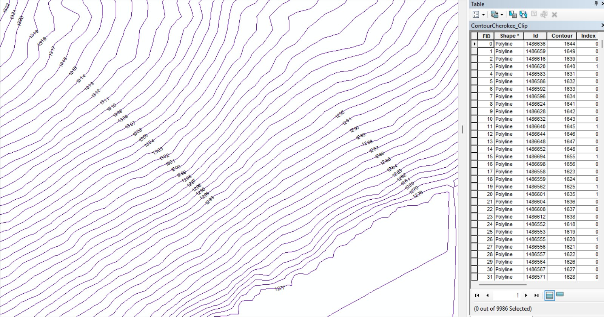

# 1-ft Contours to SHP & KMZ: Cherokee County, NC

**Category:** GIS Data Engineering & CAD &nbsp;·&nbsp; **Location:** Cherokee County, North Carolina, USA &nbsp;·&nbsp; **Year:** 2026  
**Client:** Upwork client (5.0★)  
**Tools & data:** ArcMap, Contour data, Shapefile, KMZ

*Figure 1. Area of interest (red box) over the Hiwassee River and Apalachia Lake, Cherokee County, NC*

*Figure 2. Clipped 1-ft contours with elevation labels and the contour attribute table (9,986 features)*

## Overview
Clipped 1-ft contours to a client's area of interest in Cherokee County, North Carolina, and delivered them as an attributed shapefile and a KMZ for Google Earth.

## Challenge
The client needed detailed 1-ft contours for a site near the Hiwassee River and Apalachia Lake, in formats they could use both in GIS and in Google Earth. The full delivery came to more than 700 MB.

## Data
- 1-ft contour data for Cherokee County, North Carolina (vector contours and a raster contour layer)
- Client's centre point, used to build a one-mile buffer and the area-of-interest box
- Esri World Street Map basemap for checking

## Approach
1. Plotted the client's centre point and built a one-mile buffer and an area-of-interest box around it
2. Clipped the contours to the AOI, keeping the elevation (Contour) and index-contour (Index) attributes
3. Checked contour continuity and elevation labels at large scale
4. Exported the clipped contours as a shapefile and as a KMZ for Google Earth

## Results
- 9,986 contour lines in the area of interest at a 1-ft interval, with every fifth foot flagged as an index contour
- Elevations run from about 1,277 ft near the lake shore to over 1,650 ft on the ridges
- Delivered as SHP and KMZ, more than 700 MB in total

---
[← All projects](../../README.md) · [Portfolio website](https://abdul-haleem-khan-rs-gis.github.io/Geospatial_Portfolio/projects/scanned-contours-to-kmz.html)
