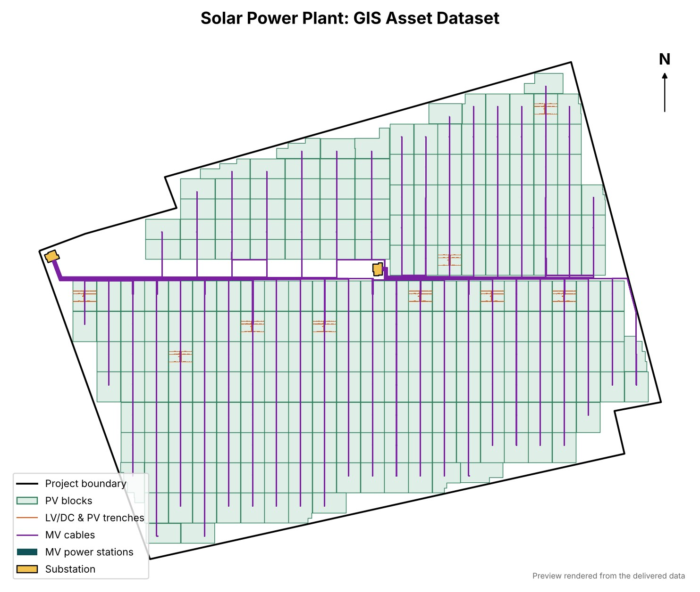

# Solar Power Plant GIS Dataset

**Category:** GIS Data Engineering & CAD &nbsp;·&nbsp; **Location:** Solar power plant site, Saudi Arabia &nbsp;·&nbsp; **Year:** 2026  
**Client:** Engineering firm (5.0★, $1,000)  
**Tools & data:** ArcGIS Pro, AutoCAD, Shapefile

*Figure 1. Project boundary, PV blocks, trenches, MV cables, power stations and substation (preview rendered from the delivered shapefiles)*

## Overview
Built the GIS dataset for a solar power plant from engineering drawings, in three approved milestones.

## Challenge
An engineering firm needed a complete GIS asset dataset for a solar power plant, built from engineering drawings and approved milestone by milestone.

## Data
- Engineering layout drawings (CAD) supplied by the client
- All layers built in WGS 84 / UTM zone 38N (EPSG:32638)

## Approach
1. Milestone 1 (approved): fenced project boundary, 240 PV block boundaries with Block IDs, 2 substations and 960 MV power-station components (240 each of RMU, transformer, inverter and UPS)
2. Pile layer: 547,055 pile points with easting, northing and Block ID
3. LV/DC trench layers split by trench width (350, 425, 550, 675, 1,300, 1,550 and 1,800 mm, all 900 mm deep), plus PV trenches and 12-in-1 and 16-in-1 DC combiner-box trenches
4. Milestone 2 (approved): MV cable layer, 624 segments in 12 MV trench circuits
5. Milestone 3 (approved): all review comments closed

## Results
- A plant of about 38 km² inside the fence, laid out in 240 blocks covering about 32.6 km²
- Cable network: about 295 km of MV cable routes and about 149 km of LV trenches, each attributed to its block
- Full set of attributed shapefiles delivered across three approved milestones ($1,000 contract)
- Client review: “He did very well Job delivered his project on time.”

## Deliverables

- FINAL SHAPEFILES.zip
- Piles_Points.zip
- Trenches SHP.rar
- MV_Details.rar

*Map preview rendered from the delivered shapefiles.*

---
[← All projects](../../README.md) · [Portfolio website](https://abdul-haleem-khan-rs-gis.github.io/Geospatial_Portfolio/projects/solar-plant-gis-dataset.html)
