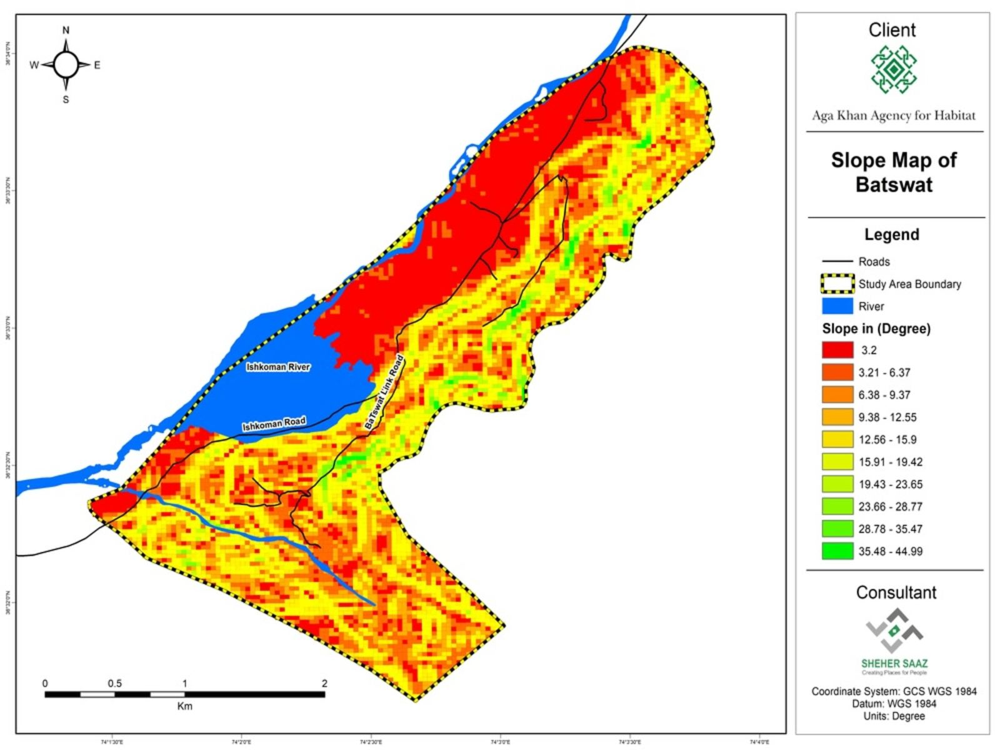
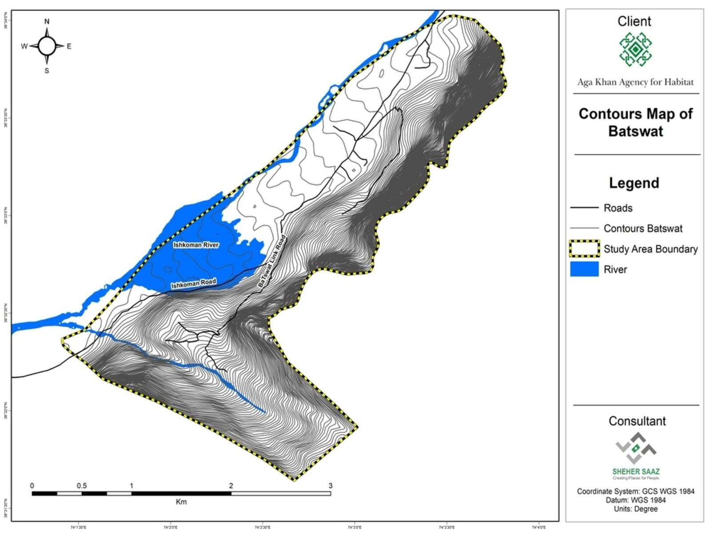

# Batswat Habitat Planning: Terrain Assessment

**Category:** Master Plans & Municipal GIS &nbsp;·&nbsp; **Location:** Batswat, Pakistan &nbsp;·&nbsp; **Year:** 2022–2024  
**Client:** Aga Khan Agency for Habitat · via Shehersaaz  
**Tools & data:** ArcGIS, DEM, Slope & contour analysis

*Figure 1. Location and land-use map of Batswat with inset maps*

*Figure 2. Slope map (degrees)*

*Figure 3. Contour map*

## Overview
Base maps for a habitat planning study: a location and land-use map, a slope map and a contour map of the Batswat study area.

## Challenge
Understand the terrain constraints of the Batswat study area for a habitat planning study.

## Approach
1. DEM processing
2. Slope in degrees, classified
3. Contour generation
4. Location and land-use map with inset maps

## Results
Location, slope (in degrees) and contour maps used to read terrain constraints and the river corridor for habitat planning.

---
[← All projects](../../README.md) · [Portfolio website](https://abdul-haleem-khan-rs-gis.github.io/Geospatial_Portfolio/projects/batswat-terrain-assessment.html)
