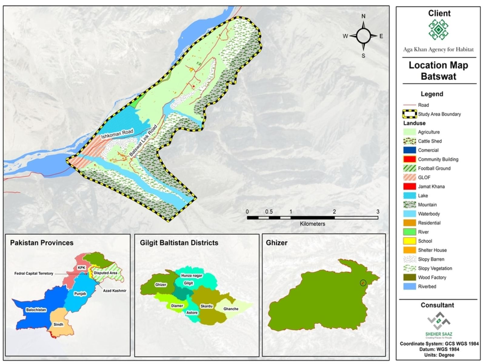

# Batswat Habitat Planning: Terrain Assessment

**Category:** Master Plans & Municipal GIS &nbsp;·&nbsp; **Location:** Batswat, Ishkoman valley, Ghizer, Gilgit-Baltistan, Pakistan &nbsp;·&nbsp; **Year:** 2022–2024  
**Client:** Aga Khan Agency for Habitat · via Shehersaaz  
**Tools & data:** ArcGIS, DEM, Slope & contour analysis

*Figure 1. Location and land-use map of Batswat with inset maps*

*Figure 2. Slope map (degrees)*

*Figure 3. Contour map*

## Overview
Base maps for a habitat planning study: a location and land-use map, a slope map and a contour map of the Batswat study area.

## Challenge
Understand the terrain constraints of the Batswat study area for a habitat planning study.

## Data
- DEM of the study area
- Land-use survey (agriculture, cattle sheds, sloping barren and vegetated land, community buildings, school, Jamat Khana, wood factory and others)
- Ishkoman River, Ishkoman Road and Batswat Link Road
- Pakistan, Gilgit-Baltistan and Ghizer boundaries for the insets

## Approach
1. Mapped land use in the study area, including a GLOF (glacial lake outburst flood) zone
2. Processed the DEM and calculated slope in degrees, in 10 classes from under 3.2° to 45°
3. Generated contours across the study area
4. Built a location map with insets for Pakistan, Gilgit-Baltistan and Ghizer

## Results
- Flat land (under about 3°) is limited to the river terrace along the Ishkoman River in the north-west
- Slopes rise steeply to the south-east, up to about 45°, which limits where new homes can go
- A GLOF hazard area at the south-west end of the valley was mapped as a constraint for habitat planning

---
[← All projects](../../README.md) · [Portfolio website](https://abdul-haleem-khan-rs-gis.github.io/Geospatial_Portfolio/projects/batswat-terrain-assessment.html)
