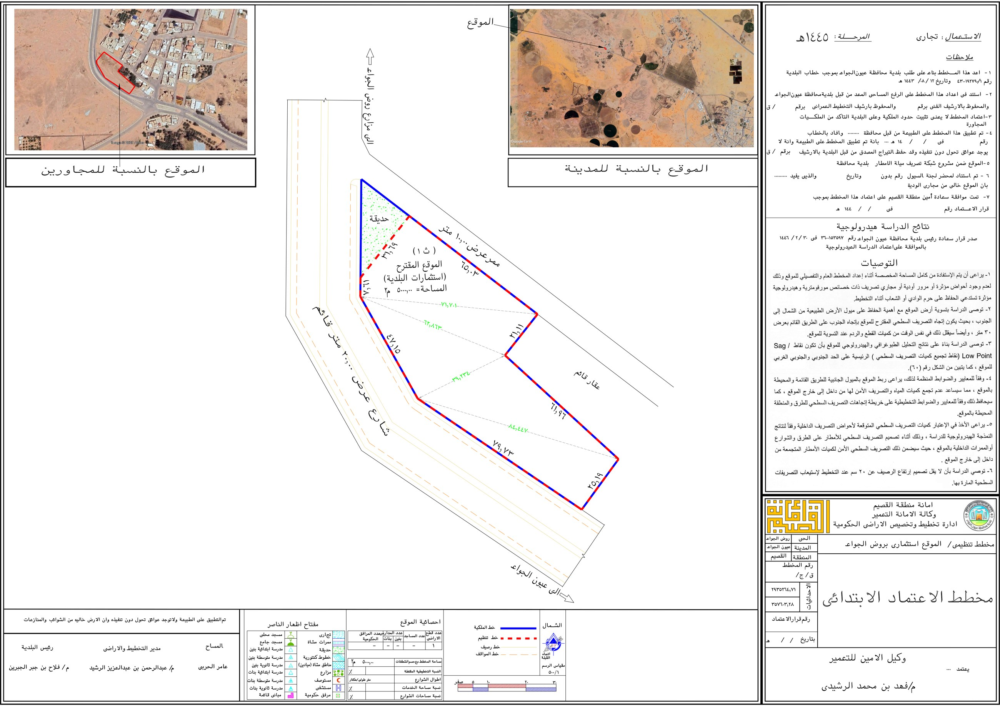

# Rawd Al-Jawa Municipal Investment Site: AutoCAD Regulatory Plan

**Category:** Master Plans & Municipal GIS &nbsp;·&nbsp; **Location:** Rawd Al-Jawa, Uyun Al Jawa, Al-Qassim, Saudi Arabia &nbsp;·&nbsp; **Year:** 2024–2026  
**Client:** Municipality of Uyun Al Jawa · Al-Qassim Region Municipality (Amanah)  
**Tools & data:** AutoCAD 2023, Scanned-map digitising, Google Earth, Cadastral drafting

*Figure 1. Preliminary-approval regulatory plan of the Rawd Al-Jawa investment site, drafted in AutoCAD from an old scanned map (1:500)*

## Overview
Redrew an old scanned municipal map as an accurate AutoCAD regulatory plan for a 5,000 m² commercial investment site in Rawd Al-Jawa, prepared for preliminary approval by the Al-Qassim Region Municipality.

## Challenge
The municipality's only record of the site was an old scanned paper map. It needed an accurate, dimensioned plan drawn to the Al-Qassim Region Municipality's standard so the plot could go forward for preliminary approval as a municipal investment site.

## Data
- Old scanned municipal map of the site (the source drawing)
- Municipality survey (field survey prepared by the Municipality of Uyun Al Jawa)
- Google Earth imagery for the two location insets (site in relation to neighbours and to the city)
- Hydrological study results approved by decision of the head of Uyun Al Jawa Municipality (1446 AH)

## Approach
1. Brought the scanned map into AutoCAD and redrew the plot boundary to scale
2. Drafted the ownership line and the regulation line, and divided the site into the proposed investment plot (Th 1) and a garden area
3. Dimensioned every boundary segment (for example 65.03 m, 79.73 m, 61.96 m, 47.15 m, 25.19 m) and the control diagonals, and calculated the area
4. Added the surrounding context: the existing 20 m street, the 10 m walkway and the neighbouring existing property
5. Added location insets from Google Earth imagery, the north arrow, a 1:500 scale bar, legend and site statistics table
6. Completed the Amanah title block, land-use and phase fields, approval notes and the hydrological study recommendations

## Results
- Proposed municipal-investment site (Th 1): 5,000 m², commercial use, phase 1445 AH, with a garden area in the northern corner
- Bounded by an existing 20 m street to the west and south-west and a 10 m walkway to the north-east
- The hydrological study found no wadi channels or drainage courses through the site, so the whole area can be used
- Recommendations shown on the plan: grade the site following the natural north-to-south slope, drain surface water south to the existing road, link to the adjoining road slopes, and design curbs at least 20 cm high
- Issued as the preliminary-approval plan (مخطط الاعتماد الابتدائي) of the Planning and Government Land Allocation Department, Al-Qassim Region Municipality

## Deliverables

- Rawd Al-Jawa investment site plan (AutoCAD plot).pdf

---
[← All projects](../../README.md) · [Portfolio website](https://abdul-haleem-khan-rs-gis.github.io/Geospatial_Portfolio/projects/rawd-al-jawa-investment-site-plan.html)
