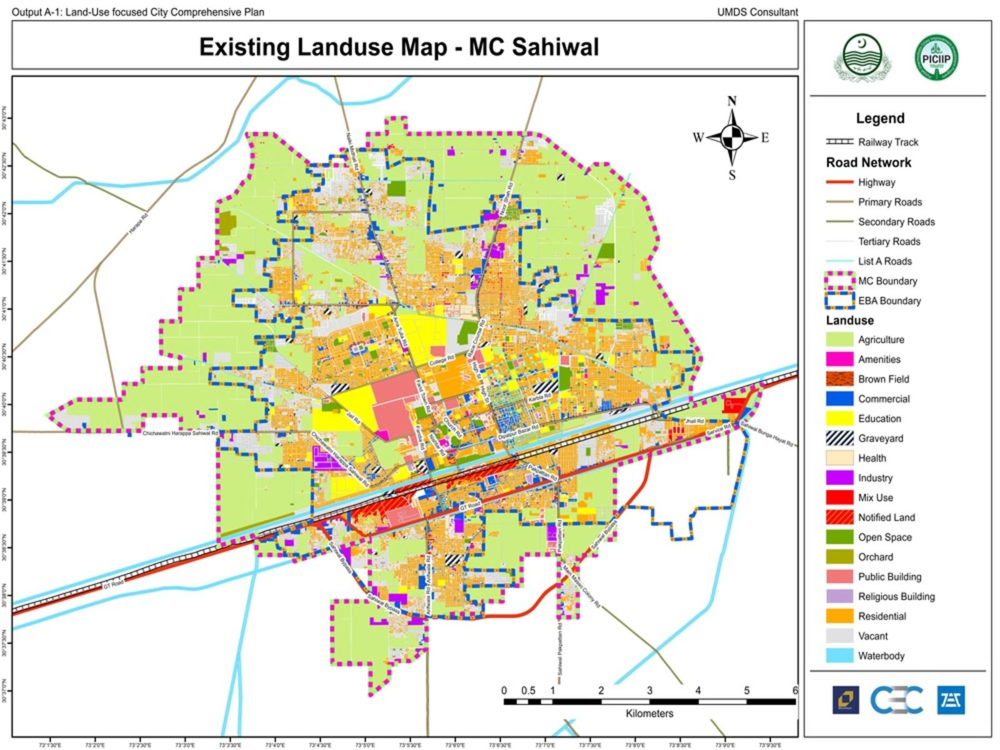
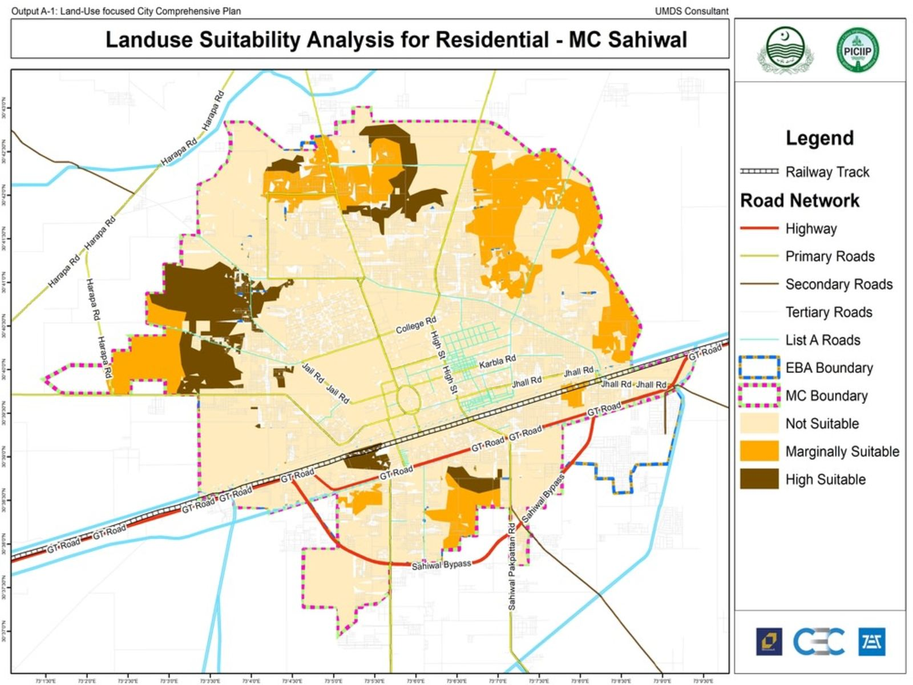

# Sahiwal Land-Use City Comprehensive Plan (2022–2042)

**Category:** Master Plans & Municipal GIS &nbsp;·&nbsp; **Location:** Municipal Committee Sahiwal, Punjab, Pakistan &nbsp;·&nbsp; **Year:** 2022–2024  
**Client:** PICIIP, Government of Punjab · via Shehersaaz (UMDS Consultant)  
**Tools & data:** ArcGIS, Land-use survey, Suitability analysis

*Figure 1. Existing land-use map of MC Sahiwal*

*Figure 2. Land-use suitability analysis for residential use*

*Figure 3. Land-use suitability analysis for industry*

*Figure 4. Site Development Zone, Scenario III (2022–2042)*

## Overview
GIS mapping and analysis for Output A-1 of the Land-Use Focused City Comprehensive Plan for Sahiwal under the Punjab Intermediate Cities Improvement Investment Program (PICIIP).

## Challenge
Prepare the GIS base and analysis for Sahiwal's land-use focused city comprehensive plan to guide growth to 2042.

## Data
- Land-use survey of MC Sahiwal (17 land-use classes)
- Road hierarchy, GT Road, Sahiwal Bypass and railway
- MC (2013 and 2019), EBA boundaries, state land and approved housing societies
- Proposed water supply and sewerage system (NESPAK)
- Imagery

## Approach
1. Mapped existing land use across 17 classes, from residential, commercial and industry to orchards, graveyards and vacant land
2. Residential suitability analysis, classed as highly, marginally or not suitable
3. Industrial suitability analysis with the same three classes
4. Development scenarios to 2042; for Scenario III, laid out residential zones 1–4, commercial and infill mixed-use zones, proposed industry, reserved agriculture and a proposed ring road
5. Overlaid the proposed water supply and sewerage network on the development zones

## Results
- The built-up core sits along GT Road and the railway, surrounded by agricultural land inside the MC boundary
- The most suitable land for new housing lies in the west and north, with marginal land in the north-east
- Highly suitable industrial land is limited, mainly in the west near Harappa Road
- Scenario III directs growth into four residential zones inside a proposed ring road, with industry in the east and south-west and agriculture reserved to the west

---
[← All projects](../../README.md) · [Portfolio website](https://abdul-haleem-khan-rs-gis.github.io/Geospatial_Portfolio/projects/sahiwal-city-comprehensive-plan.html)
