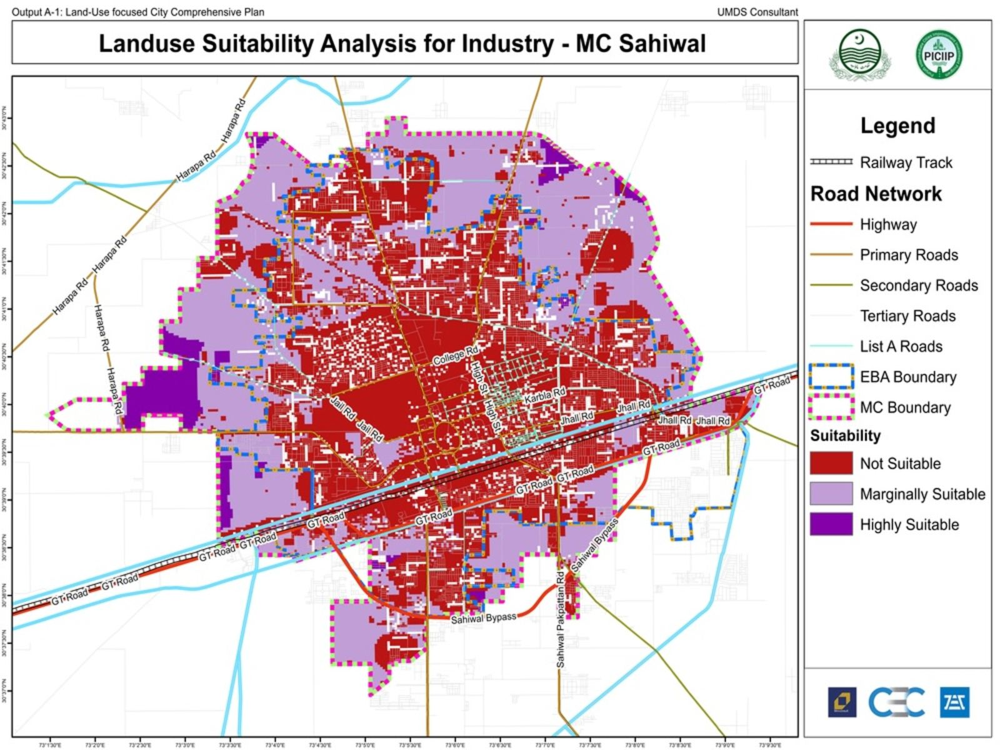
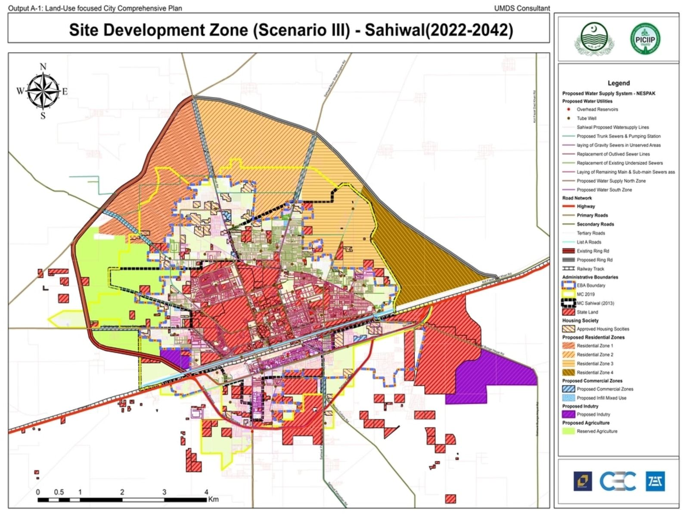

# Sahiwal Land-Use City Comprehensive Plan (2022–2042)

**Category:** Master Plans & Municipal GIS &nbsp;·&nbsp; **Location:** Municipal Committee Sahiwal, Punjab, Pakistan &nbsp;·&nbsp; **Year:** 2022–2024  
**Client:** PICIIP, Government of Punjab · via Shehersaaz (UMDS Consultant)  
**Tools & data:** ArcGIS, Land-use survey, Suitability analysis

*Figure 1. Existing land-use map of MC Sahiwal*

*Figure 2. Land-use suitability analysis for residential use*

*Figure 3. Land-use suitability analysis for industry*

*Figure 4. Site Development Zone, Scenario III (2022–2042)*

## Overview
GIS mapping and analysis for Output A-1 of the Land-Use Focused City Comprehensive Plan for Sahiwal under the Punjab Intermediate Cities Improvement Investment Program (PICIIP).

## Challenge
Prepare the GIS base and analysis for Sahiwal's land-use focused city comprehensive plan to guide growth to 2042.

## Data
- Land-use survey of MC Sahiwal
- Road network, railway and administrative boundaries
- Imagery

## Approach
1. Existing land-use mapping from survey data and imagery
2. Suitability analysis for residential land use
3. Suitability analysis for industrial land use
4. Development scenarios and site development zones to 2042

## Results
Existing land-use map of MC Sahiwal, land-use suitability analyses for residential and industrial development, and the Site Development Zone (Scenario III) for the 2022–2042 plan period.

---
[← All projects](../../README.md) · [Portfolio website](https://abdul-haleem-khan-rs-gis.github.io/Geospatial_Portfolio/projects/sahiwal-city-comprehensive-plan.html)
