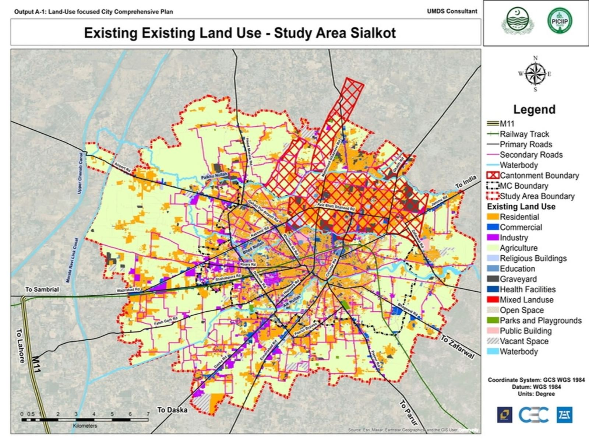

# Sialkot Land-Use City Comprehensive Plan

**Category:** Master Plans & Municipal GIS &nbsp;·&nbsp; **Location:** Sialkot, Punjab, Pakistan &nbsp;·&nbsp; **Year:** 2022–2024  
**Client:** PICIIP, Government of Punjab · via Shehersaaz (UMDS Consultant)  
**Tools & data:** ArcGIS, Land-use survey

*Figure 1. Existing land use of the Sialkot study area*

## Overview
Existing land-use mapping of the Sialkot study area for Output A-1 of the PICIIP Land-Use Focused City Comprehensive Plan.

## Challenge
Map the existing land use of the Sialkot study area as the base for its land-use focused city comprehensive plan.

## Data
- Land-use survey of the Sialkot study area (14 land-use classes)
- M11 motorway, railway, primary and secondary roads
- Upper Chenab Canal, Marala Ravi Link Canal and the city's nullahs
- MC, cantonment and study-area boundaries
- Esri/Maxar imagery basemap

## Approach
1. Land-use survey data
2. Classify and digitise parcels by use
3. Transport network and administrative boundaries
4. Plan-standard map layout

## Results
- A dense residential and commercial core around the old city, with the cantonment occupying the north-east
- Industry is scattered along the main radial roads, notably towards Wazirabad and Daska
- Agriculture still surrounds the city inside the study-area boundary, the land the plan must manage for growth

---
[← All projects](../../README.md) · [Portfolio website](https://abdul-haleem-khan-rs-gis.github.io/Geospatial_Portfolio/projects/sialkot-city-comprehensive-plan.html)
