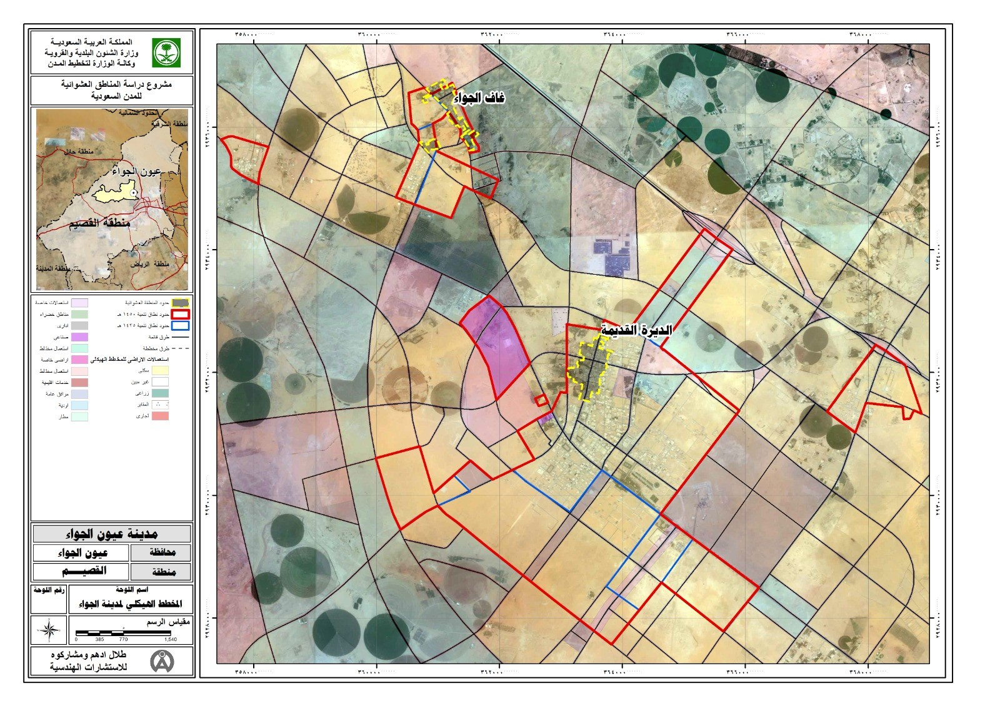

# Municipal GIS: Uyun Al Jawa, Saudi Arabia

**Category:** Master Plans & Municipal GIS &nbsp;·&nbsp; **Location:** Uyun Al Jawa Governorate, Al-Qassim, Saudi Arabia &nbsp;·&nbsp; **Year:** Jun 2024 – Jun 2026  
**Client:** Municipality of Uyun Al Jawa, Al-Qassim (GIS Engineer)  
**Tools & data:** AutoCAD, CAD-to-GIS conversion, ArcMap 10.9, ArcGIS Pro, Geodatabases, GPS field survey

*Figure 1. Municipal Lands Plans Document, Uyun Al Jawa Governorate: land use, municipal investment lands, urban boundaries and roads (ArcMap, 2025)*

*Figure 2. Areas reserved for municipal investments, classified as new or existing, with new subdivision plans and the development boundary (ArcMap, 2026)*

*Figure 3. Government Residential Plan 2505/ق (amended), Uyun Al Jawa, 1:5000: final AutoCAD drawing with plot tables, road cross-sections, notes and title block*

*Figure 4. Plan 2505 detail: central mosque square, schools, health centre, parks and walkways, parking and numbered plots*

*Figure 5. Government Residential Plan 3045/ق, east of Uyun Al Jawa, 1:1500: 72 plots, 2 mosques, a boys' school, road cross-sections, plot tables and building regulations (final AutoCAD drawing)*

*Figure 6. Structural plan of Al-Jawa city from the national informal-settlements study (Ministry of Municipal and Rural Affairs; Talal Adham & Partners), used as a planning reference*

## Overview
Two years as the municipality's GIS Engineer: drawing municipal plans in AutoCAD, transferring them accurately into GIS, and building from them the official Municipal Lands Plans Document for the governorate, the map of areas reserved for municipal investments, final AutoCAD drawings of government residential plans 2505 and 3045, and the spatial databases behind municipal planning decisions.

## Challenge
Uyun Al Jawa Governorate in Al-Qassim is growing around several settlements, including Uyun Al Jawa city, Al-Jawa, Rawd Al-Jawa and Ghaf Al-Jawa. The municipality needed one reliable, approved picture of its land: what each area is zoned for, which land belongs to the municipality and is reserved for investment, where the urban boundary runs, and how new subdivisions fit in. Most plans existed only as AutoCAD drawings, so they had to be brought accurately into GIS before they could be mapped together. These are the maps planners, the Amanah and the Ministry sign off on.

## Data
- Municipal parcel and subdivision plans (approved plan numbers, e.g. 3045/ق)
- Land-use survey and municipal land records (allocated and reserved investment lands)
- Urban boundary, development-limit and municipal-services boundaries
- Road network by class (30 m secondary and main, 40 m arterial, 100 m ring road)
- High-resolution satellite imagery as the map base

## Approach
1. Drew municipal subdivision plans in AutoCAD to Ministry drafting standards: plot boundaries, regulation lines, roads with their widths, services and land-use tables (e.g. Government Residential Plans 2505 and 3045)
2. Transferred each AutoCAD plan into GIS accurately: cleaned the drawing (closed plot polygons, removed duplicates and gaps), set the correct coordinate system (UTM) and placed it on its true location
3. Checked the positional accuracy of each transferred plan against high-resolution satellite imagery, survey points and neighbouring approved plans, adjusting it until plot and road edges matched
4. Converted the CAD layers into GIS feature classes (plots, blocks, roads, services, boundaries) and attached attributes: plan number, plot number, land use, area and ownership status
5. Merged all transferred plans into the municipal geodatabase, keeping topology clean so neighbouring plans meet without overlaps or gaps
6. Built the Municipal Lands Plans Document from this database (ArcMap 10.9, 2025): land use in 11 classes, municipal lands allocated or reserved for investment, urban and development boundaries and the road hierarchy, with definitions, general rules and the approval block for the municipality, the Al-Qassim Region Municipality and the Ministry of Municipalities and Housing
7. Mapped the areas reserved for municipal investments (2026) from the same database, classifying each site as new or existing and overlaying the new subdivision plans and the development boundary
8. Coordinated GPS field collection, shared GIS data across departments and delivered GIS training to Uyun Al Jawa staff

## Results
- A complete CAD-to-GIS workflow: every plan is drawn in AutoCAD, transferred into GIS at its true location, and becomes part of one municipal database
- One approved reference map of land use and municipal land for the whole governorate, built from the transferred plans and signed off up to the Amanah and the Ministry
- A clear inventory of the municipality's investment land, separating new reservations from existing ones
- Plans linked to the GIS by plan and plot number, so planners can move between the AutoCAD drawing and the map for any parcel

## Deliverables

- Uyun Al Jawa - Municipal Lands Plans Document.pdf
- Uyun Al Jawa - Areas Reserved for Municipal Investments (58).pdf
- Plan 2505 - Government residential plan, amended.pdf + AutoCAD .dwg
- Plan 3045 - Government residential plan.pdf + AutoCAD .dwg

*See also the Rawd Al-Jawa investment site plan, drafted in AutoCAD for the municipality.*

---
[← All projects](../../README.md) · [Portfolio website](https://abdul-haleem-khan-rs-gis.github.io/Geospatial_Portfolio/projects/uyun-al-jawa-municipal-gis.html)
