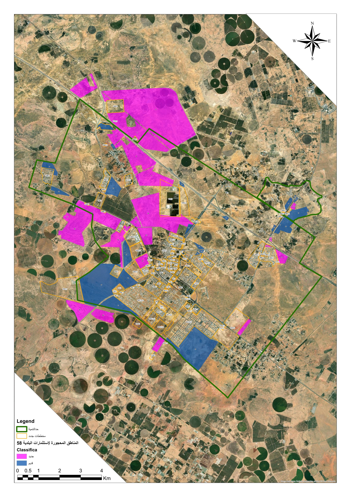
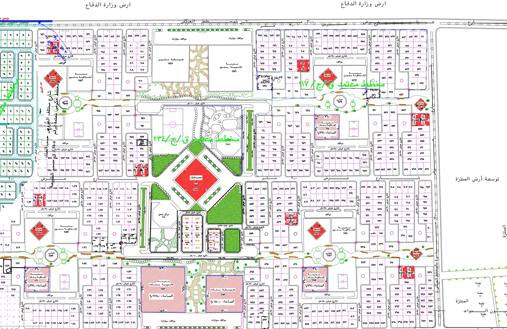

# Municipal GIS: Uyun Al Jawa, Saudi Arabia

**Category:** Master Plans & Municipal GIS &nbsp;·&nbsp; **Location:** Uyun Al Jawa Governorate, Al-Qassim, Saudi Arabia &nbsp;·&nbsp; **Year:** Jun 2024 – Jun 2026  
**Client:** Municipality of Uyun Al Jawa, Al-Qassim (GIS Engineer)  
**Tools & data:** ArcMap 10.9, ArcGIS Pro, AutoCAD, Geodatabases, GPS field survey

*Figure 1. Municipal Lands Plans Document, Uyun Al Jawa Governorate: land use, municipal investment lands, urban boundaries and roads (ArcMap, 2025)*

*Figure 2. Areas reserved for municipal investments, classified as new or existing, with new subdivision plans and the development boundary (ArcMap, 2026)*

*Figure 3. Government Residential Plan 2505/ق (amended), Uyun Al Jawa, 1:5000: final AutoCAD drawing with plot tables, road cross-sections, notes and title block*

*Figure 4. Plan 2505 detail: central mosque square, schools, health centre, parks and walkways, parking and numbered plots*

*Figure 5. Government Residential Plan 3045/ق, east of Uyun Al Jawa, 1:1500: 72 plots, 2 mosques, a boys' school, road cross-sections, plot tables and building regulations (final AutoCAD drawing)*

*Figure 6. Structural plan of Al-Jawa city from the national informal-settlements study (Ministry of Municipal and Rural Affairs; Talal Adham & Partners), used as a planning reference*

## Overview
Two years as the municipality's GIS Engineer: the official Municipal Lands Plans Document for the governorate, the map of areas reserved for municipal investments, final AutoCAD drawings of government residential plans 2505 and 3045, and the spatial databases behind municipal planning decisions.

## Challenge
Uyun Al Jawa Governorate in Al-Qassim is growing around several settlements, including Uyun Al Jawa city, Al-Jawa, Rawd Al-Jawa and Ghaf Al-Jawa. The municipality needed one reliable, approved picture of its land: what each area is zoned for, which land belongs to the municipality and is reserved for investment, where the urban boundary runs, and how new subdivisions fit in. These are the maps planners, the Amanah and the Ministry sign off on.

## Data
- Municipal parcel and subdivision plans (approved plan numbers, e.g. 3045/ق)
- Land-use survey and municipal land records (allocated and reserved investment lands)
- Urban boundary, development-limit and municipal-services boundaries
- Road network by class (30 m secondary and main, 40 m arterial, 100 m ring road)
- High-resolution satellite imagery as the map base

## Approach
1. Maintained the municipal geodatabases: parcels, subdivision plans, land use, municipal lands and infrastructure
2. Produced the Municipal Lands Plans Document (ArcMap 10.9, 2025): land use in 11 classes, municipal lands allocated or reserved for investment, urban and development boundaries and the road hierarchy, with definitions, general rules and the approval block for the municipality, the Al-Qassim Region Municipality and the Ministry of Municipalities and Housing
3. Mapped the areas reserved for municipal investments (2026), classifying each site as new or existing and overlaying the new subdivision plans and the development boundary
4. Prepared the final AutoCAD drawing of Government Residential Plan 2505/ق (amended) at 1:5000, a full neighbourhood plan produced by the municipality's Technical Department: plot layout and area tables, mosques, boys' and girls' schools, a health centre, parks and walkways, parking, sports grounds, government sites, street-lighting poles and road cross-sections
5. Redrew the approved Government Residential Plan 3045/ق (east of Uyun Al Jawa) as a final AutoCAD sheet at 1:1500: 72 plots, 2 mosques, a boys' school complex, a car park, a roundabout on King Fahd Road, road cross-sections of 15–40 m, plot tables, building regulations and the location map
6. Coordinated GPS field collection, shared GIS data across departments and trained staff and World Bank officials

## Results
- One approved reference map of land use and municipal land for the whole governorate, signed off up to the Amanah and the Ministry
- A clear inventory of the municipality's investment land, separating new reservations from existing ones
- Government residential plans 2505 and 3045 delivered as final AutoCAD drawings and plots to Ministry drafting standards, ready for the Amanah's approval chain and linked to the GIS through their plan numbers

## Deliverables

- Uyun Al Jawa - Municipal Lands Plans Document.pdf
- Uyun Al Jawa - Areas Reserved for Municipal Investments (58).pdf
- Plan 2505 - Government residential plan, amended.pdf + AutoCAD .dwg
- Plan 3045 - Government residential plan.pdf + AutoCAD .dwg

*See also the Rawd Al-Jawa investment site plan, drafted in AutoCAD for the municipality.*

---
[← All projects](../../README.md) · [Portfolio website](https://abdul-haleem-khan-rs-gis.github.io/Geospatial_Portfolio/projects/uyun-al-jawa-municipal-gis.html)
